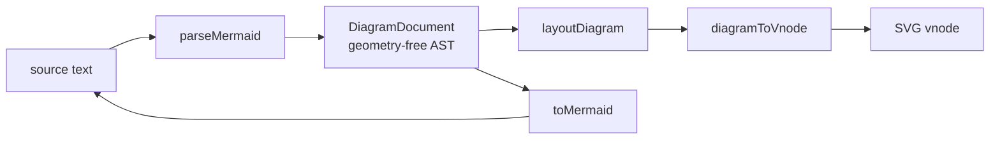
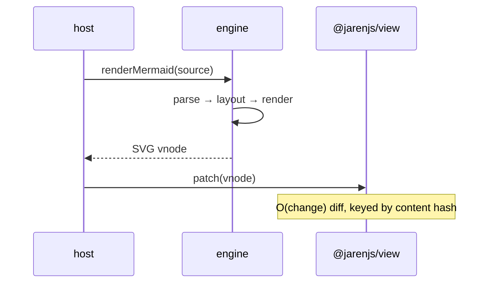
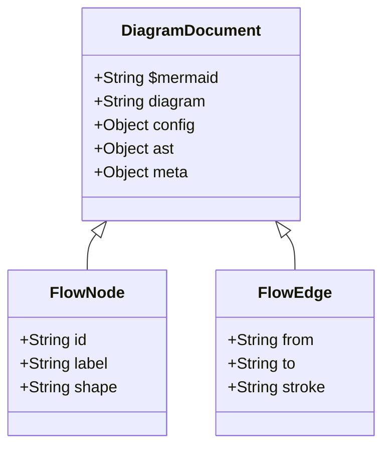
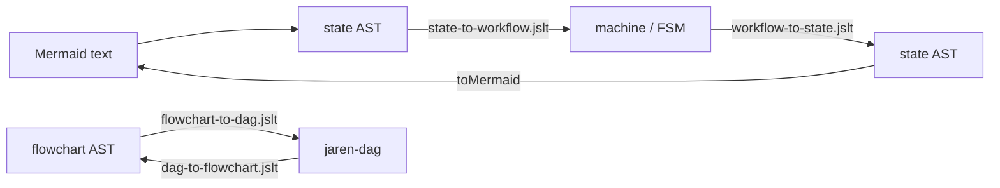
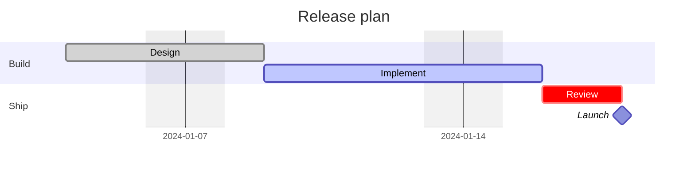
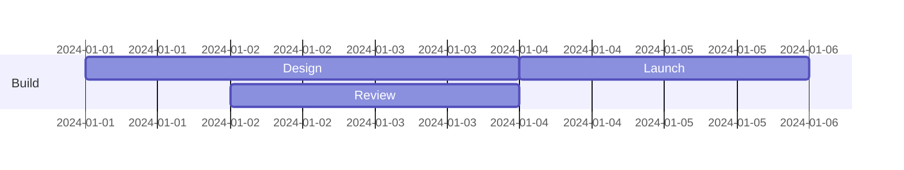
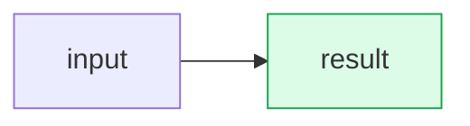
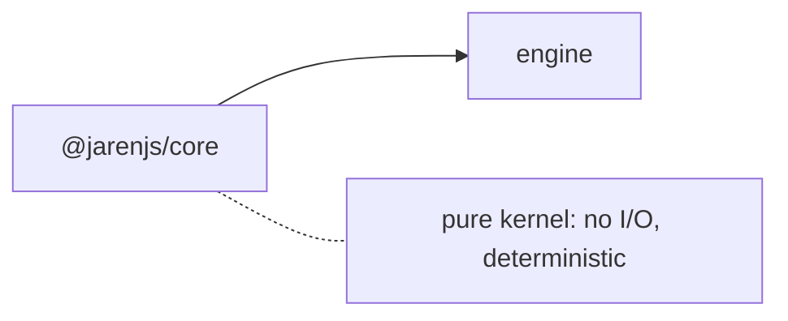

# @jarenjs/mermaid

A native, **headless** Mermaid clone: diagrams-as-code parsed to a
geometry-free JSON AST and rendered as **pure-vnode SVG** through
[`@jarenjs/view`](../../packages/view) — no `innerHTML`, no browser, no
runtime dependency on mermaid.js. It is architecturally native to the
Jaren stack: parse-once/compile-to-closures, structurally shared,
content-hash-keyed, and **bidirectional** (`parseMermaid` ⇄
`toMermaid`).

Like [`@jarenjs/md`](../md), it ships in **two layers**: a pure engine
(text ⇄ AST ⇄ vnode) that knows only the vnode shape, and a visual
component that packages it for an `@jarenjs/app` host.

## Format in one glance

```js
import { parseMermaid, toMermaid, renderMermaid } from '@jarenjs/mermaid';

const doc = parseMermaid(`flowchart TD
  A[Start] --> B{OK?}
  B -->|yes| C((Done))`);

doc.diagram;        // 'flowchart'
doc.ast.nodes[1];   // { id: 'B', label: 'OK?', shape: 'diamond' }
toMermaid(doc);     // canonical text — parseMermaid(toMermaid(doc)) deep-equals doc.ast
renderMermaid(doc); // ['svg', { viewBox, … }, …]  — a pure-vnode SVG, error-safe
```

The AST is **geometry-free**: layout is a separate pass, so the AST is a
faithful semantic model — a directed graph, an ordered interaction, a
finite state machine — that other engines project. This is the two-layer
pipeline, drawn in Mermaid (and rendered by this engine on the website):



## Usage

**Parse / print / compile (pure):**

```js
import { parseMermaid, toMermaid, compileMermaid } from '@jarenjs/mermaid';

const c = compileMermaid(source);   // parse once; cached projections
c.doc;                              // the DiagramDocument
c.toVnode();                        // pure-vnode SVG (reference-stable)
c.toSvgString();                    // standalone SVG string — SSR, no browser
c.toText();                         // canonical Mermaid (toMermaid)
c.toLayout();                       // the PositionedDiagram — pure geometry
                                    // (nodes x/y/w/h, routed edges); null for
                                    // types without a layout. The rendered
                                    // SVG also marks every node/edge of every
                                    // type with data-id /
                                    // data-edge+data-from+data-to, so editors
                                    // hit-test without re-layout.
```

**Render pipeline:**



**Component (host):**

```js
import { createMermaidComponent } from '@jarenjs/mermaid/component';
const mermaid = createMermaidComponent();
createApp(appDoc, {
  effects: { ...mermaid.effects },                       // mermaid-render, mermaid-load
  viewModel: (state) => ({ ...state, diagram: mermaid.view(state.source) }),
});
```

**Markdown plugin** — a `mermaid` fence renders inline, SSR-safe:

```js
import { parseMarkdown, mdToVnode } from '@jarenjs/md';
import { mermaidPlugin } from '@jarenjs/mermaid/plugin';
import { mermaidPieRenderer } from '@jarenjs/charts/transforms/mermaid-adapter';
const plugins = [mermaidPlugin({ renderers: { pie: mermaidPieRenderer } })];
mdToVnode(parseMarkdown(md, { plugins }), { plugins }); // fence → inline <svg>
```

## The AST node types



## Bidirectional semantic model

The geometry-free AST doubles as a reusable domain model, projected
both ways by plain JSLT stylesheets — no code, just documents. The
flagship: a `stateDiagram-v2` projects via
`stylesheets/state-to-workflow.jslt.json` into an executable machine
(the `@jarenjs/flow` jaren-fsm superset shape `{ initial, states,
transitions }`, validated by `schemas/jaren-workflow.schema.json`),
with a transition label's UML parts parsed for it: `event [guard] /
effect` become the machine's event, guard and `{ "run": effect }`
descriptor. The reverse stylesheet plus `toMermaid` turns a machine
back into editable diagram text — string guards round-trip exactly,
structured members print as documented `[…]` placeholders.

The same arrow exists for dataflow: `flowchart-to-dag.jslt.json`
projects a flowchart into a jaren-dag **skeleton** (task stubs named by
node id, edge labels becoming ports), and `dag-to-flowchart.jslt.json`
draws a real dag document as a flowchart — one shape per node kind,
ports and selects on the edge labels. Acyclicity stays `compileDag`'s
job; the projection just draws.



## Diagram coverage

Fully laid out: **flowchart**, **sequence**, **state** (through the
flowchart engine via an adapter — states as rounded nodes, `[*]` as a
filled start dot and an end ring, verbatim transition labels on the
edges; composite states stay flattened in v1) and **gantt** (a real time
axis — see below). Structured panels / chart: **class**, **ER**,
**pie**. Parse-accepted with an
honest "not yet laid out" placeholder: mindmap, gitGraph, journey,
timeline, quadrantChart, requirement. The benchmark's coverage scorecard reports this
without hiding gaps.


## Gantt: the date directives are interpreted

A Gantt diagram is parsed into a **resolved schedule** and rendered as a
timeline — an aligned time axis, section bands, bars, milestone
diamonds, dependency connectors and shaded excluded days:



Every directive means something. `dateFormat` compiles to a strict date
parser, `axisFormat` to the axis labels, `tickInterval` and `weekday` to
the tick boundaries, and `excludes`/`includes`/`weekend` to a working
calendar that moves a duration-derived end past the days it skips (an
`includes` date is a working day whatever `excludes` says), while
`inclusiveEndDates` makes an end written as a date the last day worked. Tick positions come
from `@jarenjs/core/dates` — the same ladder the chart component's time
axis reads — so a timeline and a chart cannot disagree about where a
week begins.

Two more switches are Mermaid *config*, not header lines, and are read the
way Mermaid reads them. `gantt.topAxis` (a second row of date labels under
the rows) and `gantt.displayMode: compact` (tasks that do not overlap share
a row, with the name on the bar) go in the front matter's `config` or an
`%%{init}%%` directive, and a top-level front-matter `displayMode: compact`
is the shorthand for the second:



A bare `topAxis` line in the diagram's body does the same here, though Mermaid
11.16.1 fails on it.

`click` statements are read too. `click a1 href "https://example.test/p"` puts
a link on the task, but only a URL the package's `sanitizeHref` allow-list
passes (http and https URLs, `mailto:`, a fragment, protocol-relative URLs and
root-relative or dot-relative paths): `javascript:`, `data:`, `vbscript:` and a
bare `page.html` leave the task without a link. `click a1 call report(a1, "two words")` is **recorded
and never run**: the tree keeps the name and the argument strings in
`ast.clicks`, the diagram draws nothing for it, and a host that wants the call
decides what the name means. The reasons are that a diagram's text must not
choose which function a page runs, and that Mermaid's default level binds
nothing either.

Each task carries `{ id, flags, start, end, duration, after, line }`
beside its raw `info`, with `start`/`end` as epoch milliseconds and the
interval half-open. The grammar, the vendored conformance table and the
ten deliberate divergences from Mermaid are in
[docs/MERMAID-FORMAT.md §4.4](./docs/MERMAID-FORMAT.md). The load-bearing
one: **there is no clock here**, so a schedule with no dated anchor is a
line-aware error rather than a diagram whose meaning changes daily.

Mermaid's `dateFormat` is moment's grammar and its `axisFormat` is
strftime; neither is LDML, so each has its own tokenizer and each token
is mapped individually onto the core date kernel. A `dateFormat` of
exactly `X` or `x` reads each date as an instant, in epoch seconds or
milliseconds. An unsupported token is refused by name rather than passed
through as text.

**Localized labels take an injected provider.** This engine ships no
month or weekday names, so `axisFormat %b %Y` (or a `dateFormat` with
`MMMM`) needs one — the same `DateNames` record
`@jarenjs/locales`' `compileDateLocale(pack).names` produces:

```js
import { compileDateLocale, nl } from '@jarenjs/locales';
renderMermaid(source, { dateNames: compileDateLocale(nl).names });
```

`compileMermaid`, `mermaidPlugin` and `createMermaidComponent` take the same
`dateNames` option, and the same `parseFrontmatter` hook for a front-matter
parser of the host's own. Without a provider a name token is a compile
error, not a silent English fallback. Task ids and dates stay ASCII data
either way — an RTL name is text, not syntax.

At scale, parse (which is also schedule resolution), layout and render
are reported separately in the benchmark: <!--fact:mermaid.ganttScale-->at 10,000 tasks, ~34 ms to parse and resolve, ~4 ms to lay out and ~7.9 ms to render<!--/fact-->.


## Styling, notes and interaction

**`classDef` / `class` / `style` now paint.** The parser always recorded them;
nothing consumed them, so a styled node rendered exactly like an unstyled one.
They resolve per node in Mermaid's own precedence — classDef in application
order, then a per-node `style` — and reach the shape as SVG attributes:



**`note` is a built-in class.** Mermaid has no flowchart note, and a diagram
that cannot annotate a node loses exactly what an ASCII drawing used to carry
in a margin comment. Rather than invent syntax, apply the standard `class`
statement and the node is themed from the same `note*` tokens the sequence
renderer uses — dashed border, note fill, following light/dark:



A dotted link to a note-classed node reads as an annotation, and the document
stays valid Mermaid that any other tool can still parse — no dialect, no
compatibility cost.

**The label stays readable on whatever fill you pick.** A `fill` you name is a
constant — it does not follow light/dark — so the ink over it must not follow
the theme either, or a pale box under a dark theme gets pale text and the
label vanishes into it. The ink is derived from the fill's measured contrast
instead, and is guaranteed to clear WCAG AA for any colour. Name a `color`
yourself and that always wins.

**HTML labels when the host asks for them.** Pass `htmlLabels: true`
(Mermaid's own spelling) in the render options and flowchart and state
diagrams draw their labels as HTML inside a `foreignObject`; a diagram's own
`htmlLabels: false` still turns them off, but its `htmlLabels: true` alone
does not turn them on. A line wider than
`flowchart.wrappingWidth` (200px by default) wraps. The wrapping and the box
sizes come from the same advance table that sizes SVG text, so the server
render and the browser render agree and nothing is read from a DOM; a label
that does not wrap lays out exactly as it does as SVG text. Unset, labels
stay SVG text, where Mermaid's own default is HTML. Only a renderer that
draws `foreignObject` (a browser) shows HTML labels: an SVG file meant for a
rasterizer leaves them off.

```js
import { compileMermaid } from '@jarenjs/mermaid';

const source = `flowchart TD
  A[The quick brown fox jumps over the lazy dog twice] --> B[Done]`;

compileMermaid(source, { htmlLabels: true }).toLayout().nodes[0].lines;
// ['The quick brown fox jumps over', 'the lazy dog twice']
compileMermaid(source, { htmlLabels: true }).toSvgString();
// '<svg …><foreignObject …><div xmlns="http://www.w3.org/1999/xhtml" class="mm-label" …><div>The quick brown fox jumps over</div>…'
compileMermaid(source).toSvgString().includes('foreignObject'); // false
```

The `@jarenjs/view` safe policy drops `foreignObject`, and the labels in it —
which is why a diagram cannot enable HTML labels by itself: a host that
renders through that policy and passes nothing keeps SVG text. `safe: true`
(to `renderMermaid`, `mermaidPlugin`, `createMermaidComponent`, …) keeps
SVG text even beside `htmlLabels: true`.

**Pan, zoom and touch are opt-in.** `mermaidPlugin({ interactive: true })`
adds a `hydrate` that attaches to the finished SVG; the render is unchanged
and server output is byte-identical either way, so a page that does not ask
for it never loads the module.

```javascript
createMdComponent({ plugins: [mermaidPlugin({ theme: 'host', interactive: true })] });
```

The interaction rules are chosen so a figure never fights the page it sits in:

| gesture | behaviour |
|---|---|
| plain wheel | **scrolls the page** — hijacking it is how embedded viewers ruin a document |
| ctrl/⌘ + wheel | zooms toward the pointer |
| one-finger drag | pans **only once zoomed in**; at rest the swipe is the page's, and `touch-action` is switched to say so |
| two fingers | always pinch-zooms |
| double-click / tap | zooms in, or resets when already zoomed |
| keyboard | `+` `-` `0` and arrows, on a focusable figure with an aria-label |

Everything runs on the SVG's `viewBox` — four numbers changing. Nothing
re-renders, nothing re-parses, and the view is clamped so it can never be
panned off its own canvas.

**Tooltips are a second opt-in.** `mermaidPlugin({ tooltips: true })`
(alone, or beside `interactive: true`) hydrates every node and edge a diagram
draws with a tooltip: flowchart, state and jaren-dag nodes and links, sequence
actors (both boxes) and messages, class and ER boxes and the rows of their
relations box, gantt rows and their dependency connectors. A node's tooltip
reads its label and id, what flows into it and what it leads to, named by the
neighbours' labels and the edges' own; an edge's reads its two ends and its
label (`Start → Done (yes)`). Every type writes the same markers — a node group
with `mm-node` and `data-id`, its name in an `mm-label` text; an edge with
`mm-edge`, `data-edge`, `data-from` and `data-to`, its label in an
`mm-edge-label` text — and the tooltip is built from those and the text in the
DOM, so it needs no type's code and server output is byte-identical with and
without it. A flowchart or class `click` line's own tooltip text
(`click A "https://example.test" "Opens the docs"`) is shown instead of the
derived text, as text: the render keeps it in the node's `<desc>`, escaped
like any label, and the tooltip sets it with `textContent`, so `<b>` in it is
four characters. The words `from`, `to` and the arrow are English and not
localizable.

```javascript
const plugin = mermaidPlugin({ theme: 'host', tooltips: true });
createMdComponent({ plugins: [plugin] });

// The render stays a complete SVG; the block only gains the hydrate marker.
const block = plugin.render({ value: 'flowchart LR\n  A["Start"] --> B["Done"]' });
block[1]['data-md-hydrate'];       // 'mermaid'

// The host's hydrate pass hands the rendered element back. Afterwards node A
// is focusable, and focusing (or hovering) it shows a tooltip reading
//   Start (A)
//   to: Done
await plugin.hydrate(blockElement);
```

Hover and keyboard focus show the same text. Every node and edge becomes
focusable (in drawing order: a flowchart's links before its nodes) and named,
except a gantt row that wraps a `click` link, which is reached and described
through the link, as it already takes focus. The tooltip is a `role="tooltip"`
element, and the node or edge it describes
points at it with `aria-describedby` for as long as it is shown; Escape
dismisses it, whichever of hover or focus showed it. Touch never hovers (a tap
stays the page's), so a touch user reaches the text by focusing the node. The
tooltip is `position: fixed` (and in the top layer where the browser has
popovers), so the scrolling figure neither clips it nor grows a scrollbar to
hold it; it sits under its node, or above it when there is no room below. A
pan, zoom or scroll moves the node, and a shown tooltip is placed against it
again. A pie, a placeholder and a parse error draw nothing marked, so they
are left as they are. `@jarenjs/mermaid/tooltips` exports
`attachDiagramTooltips(el)` for a host that wires its own hydration; the
stylesheet's `.mm-tooltip` rules style the result.

**A pie is drawn by the renderer the host hands in.** The pie engine lives
in [`@jarenjs/charts`](../charts), and mermaid imports no other component:
`diagramToVnode(doc, { renderers: { pie } })` — and the same option on
`renderMermaid`, `compileMermaid`, `mermaidPlugin` and
`createMermaidComponent` — draws a pie with `mermaidPieRenderer` from
`@jarenjs/charts/transforms/mermaid-adapter`, the SVG mermaid has always
emitted (a test holds it byte-identical to fixtures rendered before the
renderer was injected). Without a renderer a pie renders the placeholder
(MERMAID-FORMAT §4.5).

## Performance (measured)

Node v22.22.2, 2026-07-19, `npm run benchmark:mermaid` (run it
yourself). Mermaid has **two** parsers, so there are two honest
head-to-heads:

- **`@mermaid-js/parser`** is the standalone **Langium** parser — it
  covers only the grammars migrated off Jison (pie, gitGraph, …) and
  **cannot parse flowchart or sequence**. The overlapping type is
  **pie**, where `@jarenjs/mermaid` is comparable (~0.003–0.006 ms/op
  either way).
- **Flowchart and sequence** are still parsed by Mermaid's original
  in-tree **Jison** grammars inside the full `mermaid` package (not by
  `@mermaid-js/parser`). Against `mermaid.parse()` (DOM-coupled, run
  under jsdom), `@jarenjs/mermaid` parses the same sources **roughly two
  orders of magnitude faster**:

| flowchart/sequence parse (ms/op) | jaren-mermaid | mermaid.parse (Jison) |
|---|---|---|
| flowchart ~5 nodes | ~0.04 | ~10 |
| sequence ~5 nodes | ~0.02 | ~1.4 |
| flowchart ~25 nodes | ~0.09 | ~7 |
| sequence ~25 nodes | ~0.05 | ~4 |

(`mermaid.parse` is async and runs the whole parse front-end — type
detection + Jison + validation — so it is heavy and noisy; these are
representative, not a bare-grammar microbenchmark.)

Rendering through `diagramToVnode` costs a consumer
**<!--fact:bundle.mermaid-->93,276<!--/fact--> bytes** minified and
tree-shaken, and the import graph holds no chart or Markdown module: a pie
renderer, when a host wants one, is charts' and is handed in.
`npm run test:tree-shaking` measures both.

The headless **parse → layout → SVG string** rows are jaren-only
(<!--fact:mermaid.svgMs-->~0.35 ms for a 25-node flowchart, ~1 ms at 100 nodes<!--/fact-->): mermaid.js
needs a browser DOM (`getBBox`) to render, so there is no fair
full-render head-to-head — producing a complete standalone SVG in pure
Node is a capability it lacks.

## Design notes

- **Two layers, one-way arrow.** The engine imports only `@jarenjs/core`
  and `@jarenjs/view` (shared SVG builders from `@jarenjs/view/helpers`,
  `hashContent` from core); the component adds the app glue. The Markdown
  plugin imports nothing of md, and a pie's renderer comes from the host:
  no component imports another.
- **CSP-safe.** No `eval`, no `new Function`, no `innerHTML`. Text and
  attributes are escaped by the view serializer.
- **Structural sharing.** Same source → reference-equal vnode; a small
  source change re-emits only affected sub-scenes; block vnodes carry
  content-hash keys.

See [ARCHITECTURE.md](ARCHITECTURE.md) and
[docs/MERMAID-FORMAT.md](docs/MERMAID-FORMAT.md).

Answers that changed (upgrade notes): a state diagram never makes a state its
own ancestor (`state C { state C {` and an ancestor declared inside its own
descendant used to parse into states that were each other's parent, which
`toMermaid` refused with a bare `TypeError`); a `__proto__` key in front matter
or an init directive is a config member, where it re-parented the config
object; a quoted flowchart label may hold its own closing bracket
(`A("f(x)") --> B` used to read the label `"f(x` and silently drop the edge and
`B`), and `toMermaid` quotes a label that starts or ends with `/`, `\` or a space
so it reads back as it was; an `erDiagram` entity name in quotes may hold spaces
in a relationship as in a block (`"PRODUCT CATEGORY" ||--o{ PRODUCT : has` used
to vanish into a bogus entity), the quotes are not part of the name, and a name
with a space prints in quotes, and a bare entity line (`"E F"`, `G`) declares an
entity; a quoted relationship label is read and drawn without its quotes
(`A ||--o{ B : "has x"` draws `has x`, as Mermaid does), and `toMermaid`
quotes a label that is not one word; a `;` ends a sequence statement where each
piece of the line reads as one (`A->>B: hi; B->>A: yo` is two messages, where
it was one message whose text held the rest), and `toMermaid` prints a
message's `;` as `#59;` where the line would otherwise split; a state line
splits at `;` the same way (`A --> B; B --> C` read nothing), a state note's
text is no longer read as transitions, a state, class or ER line holding a
transition, relation or relationship that no form reads is refused with its
line where it was dropped, and an ER relationship without a label reads as
one (it opened an entity block at the brace of `o{` and swallowed the lines
after it); a `style` or `classDef` value is plain paint (a color, a number with a
unit, a dash list, `var(--name)`, `url(#id)` of the same document, or a color
function such as `rgb(10 20 30)`), and one carrying a `;`, a remote `url()` or
another function is dropped without a diagnostic, where it was written into the
shape's inline style and added declarations of its own; the component's
never-read `onHydrateError` option is gone from its type; a flowchart holds at
most 10,000 edges (`A & B & … --> C & D & …` declares one per pair, so fourteen
kilobytes of source named a million and rendered to hundreds of megabytes), and
a longer source is a `MermaidParseError` at the line that crossed the bound; an
unclosed `{` body of a class or an entity keeps its last character (the last
member of `class A {` + `-bar` read `ba`, and an entity's last `PK` was lost)
and is read in time linear in its lines; `toMermaid` keeps the order of a state
diagram's states (a labelled state used before its label line, or a child listed
before its parent, came back in another order), writes a class member holding a
`}` or starting `%%` as a `Name : member` line, prints a pie label's line break
as `<br/>`, and prints a very small or very large pie value as a plain decimal
(`1e-7` is not a number a pie row reads, so the slice vanished); an `erDiagram`
attribute keeps the quoted comment that ends its line (`string name PK "the name"`)
as a `comment` member, which `toMermaid` prints, and reads keys written
comma-separated (`PK, FK` kept only `FK`), which `toMermaid` now prints that way;
repeated gantt `excludes` lines add up, as they do in Mermaid, where the last line
used to replace the earlier ones (`excludes saturday` then `excludes sunday` with a
task `2024-01-05, 3d` ended on 2024-01-09 and now ends on 2024-01-10), and a printed
gantt holds them on one line, so its tasks sit a line higher on reading it back;
a gantt `includes` line (dates that stay working days whatever `excludes` says) and
`inclusiveEndDates` (an end written as a date is the last day worked) used to be
ignored text and now change the schedule of every document that carries them; a
trailing `%%` comment on `excludes` is skipped where it used to be refused as an
unknown term; `inclusiveEndDates` followed by anything but a comment is an error,
as in Mermaid; a task row whose name starts with `includes` or
`inclusiveEndDates` stays a task row; a bare `topAxis` line in a gantt used to
be dropped and now draws the second row of date labels; a top-level front-matter
`displayMode` now lands in `config.gantt.displayMode` for every diagram type
(so `toMermaid` prints it back in the `init` header, even for a flowchart) and
a gantt that sets it to `compact` packs its rows; and a gantt scene gained
`compact` and `bottomAxis` members and its rows gained `lane` and `labelAnchor`;
a gantt `click` statement used to fail the parse when its URL held a colon
(`click a1 href "https://example.test/p"` was read as a task row) or vanish
when it held none (`click a1 call report()`), and is now read: a gantt tree
gained a `clicks` member (a tree without one reads as no clicks), a scene row
gained `href`, a row with a link is wrapped in an anchor and gains the class
`mm-gantt-clickable`, `toMermaid` prints the statements after the tasks (so a
statement written between two tasks comes back below both, and the tasks after
it sit a line higher on reading it back), and a line that starts with `click`,
is not a click statement and carries no task colon is an error where it used
to be dropped (a task row such as `Click on href : a3, 2024-01-09, 1d` is still
a task); a flowchart's and a class diagram's `click` line used to be skipped
and is now read into a `clicks` member of the tree (a tree without one reads as
no clicks; a line that is none of Mermaid's forms is still skipped), which
`toMermaid` prints back after the styles or the relations, and a click's
tooltip text renders as a `<desc>` in its node's group; and the SVG of a
sequence, class, ER and gantt diagram gained the node and edge markers every
type now shares: an actor box's and a gantt row's group gained the class
`mm-node` and the actor box `data-id`, their names the class `mm-label`, a
message's group and a gantt connector the class `mm-edge` and `data-edge`,
`data-from` and `data-to`, a message's label the class `mm-edge-label`, a
class's or an entity's box elements are grouped under one `mm-node` group, and
each relations row under an `mm-edge` group; a sequence scene's messages gained
`from` and `to`. Flowchart and state labels are read as Mermaid reads them:
an edge label with a `<br>` draws the lines it was measured for (its text was
drawn on one line, over a background sized for two), the inline form
`A -- "x" --> B` reads as the pipe form (its quotes and `<br/>` were kept as
text, so its AST `label` and its printed form change), a quoted pipe-form label
is one unit (`A -->|"x|y"| B` read the label `"x` and an edge on to a node `y`),
`toMermaid` quotes an edge label holding a `|` or a `;`, or a quote or space at
either end (`A -->|semi;colon| B` did not parse, and `A -->|x|y| B` read back as
an edge to a new node `y`) and a subgraph title with a quote or space at either
end, a state transition or
description breaks at `<br>` (the tag was printed), a decimal entity code
(`#9829;`) is decoded,
and a markdown string (`` "`**bold**`" ``) draws its bold and italic runs
(its backticks and stars were printed), which `toMermaid` now writes quoted;
and a subgraph holding a first-rank or first-column node no longer draws its
frame and title above or left of the canvas: the diagram moves to hold every
frame, so its nodes, edges and size change. A node or edge label that no
quoting can hold — both quote kinds beside a `;` or the label's own closer, or
its closer beside a link operator — used to print source that did not parse or
read back as another graph, and now prints that one character as its decimal
entity code (`"` as `#34;`, `|` as `#124;`): the diagram reads back as the same
graph and draws the same text, and the label reads back spelled with the code. A
theme token, from a diagram's config or a host's theme, whose `(`, `[` or string
does not close is dropped (it opened a block that read every later `--mm-*`
declaration of the root style into itself); a diagram's config token holding a
remote `url()` is dropped, as a `style` statement's is (a host's own theme still
may name one); and an HTML label wraps a markdown line only at a space, where a
word whose style changes inside it (`**three**four`) could break between its runs.
A quoted inline edge label is one unit (`A -- "a --> b" --> B` read an edge to a
node `b` labelled `"a` and dropped `B`, and `A -- "x"-->B` was refused), an inline label opens only at `--`, `==`
or `-.` and a blank (`A --- B --> C` read one edge `A`→`C` labelled `B`), a `;`
separates flowchart statements only outside a label (after the apostrophe in
`A[it's] --> B; C --> D` no `;` separated and `C --> D` vanished, and `A[a;b]`
was refused), and a statement after a `;` may be a keyword's (`A --> B; style A
fill:#f00` read a node `style`; `A --> B; end` read a node `end`, and now ends the
open subgraph or, with none open, is the parse error Mermaid also gives). A named entity code (`#quot;`, `#amp;`) is
decoded in every label, where it printed as written; and the text of a sequence
actor, message and note, a class or ER panel's rows and a sequence block and
gantt row is read as a flowchart label is: its entity codes are decoded (they
printed as written), and in a sequence diagram and a panel a `<br>` breaks the
line (it printed as text), so a message, an actor, a note or a panel row that
breaks is drawn in its lines and the diagram grows to hold them, and a sequence
scene's actors, messages and notes gained `lines`.

## Exports

Every subpath a consumer can import, derived from the manifest by
`npm run docs:derive` (`npm run docs:check` fails when the two drift):

<!--fact:exports.mermaid-->
| Import | Kind | Declarations |
|---|---|---|
| `@jarenjs/mermaid` | JavaScript | declared |
| `@jarenjs/mermaid/component` | JavaScript | declared |
| `@jarenjs/mermaid/styles` | JavaScript | declared |
| `@jarenjs/mermaid/interactive` | JavaScript | declared |
| `@jarenjs/mermaid/tooltips` | JavaScript | declared |
| `@jarenjs/mermaid/plugin` | JavaScript | declared |
| `@jarenjs/mermaid/theme` | JavaScript | declared |
| `@jarenjs/mermaid/styles/mermaid.css` | asset | — |
| `@jarenjs/mermaid/schemas/jaren-mermaid-ast.schema.json` | schema | — |
| `@jarenjs/mermaid/schemas/jaren-workflow.schema.json` | schema | — |
| `@jarenjs/mermaid/stylesheets/dag-to-flowchart.jslt.json` | asset | — |
| `@jarenjs/mermaid/stylesheets/flowchart-to-dag.jslt.json` | asset | — |
| `@jarenjs/mermaid/stylesheets/state-to-statechart.jslt.json` | asset | — |
| `@jarenjs/mermaid/stylesheets/state-to-workflow.jslt.json` | asset | — |
| `@jarenjs/mermaid/stylesheets/statechart-to-state.jslt.json` | asset | — |
| `@jarenjs/mermaid/stylesheets/workflow-to-state.jslt.json` | asset | — |
| `@jarenjs/mermaid/package.json` | metadata | — |
<!--/fact-->
