# @jarenjs/validate Architecture

**IMPORTANT**: Update this document only when introducing architectural changes. If multiple architects are involved, ensure consensus on significant changes.

## Overview

**@jarenjs/validate** is a high-performance JSON Schema validator for JavaScript/TypeScript. It implements a **compilation-based architecture** that transforms JSON Schemas into optimized validation functions at build time, rather than interpreting schemas during validation. This design choice delivers significant performance advantages over traditional interpretation-based validators.

### Core Design Philosophy

```
Schema → Compile → Optimized Validator Function → Execute against Data
```

The validator embraces these architectural principles:

1. **Compile-Time Optimization**: Schemas are parsed and compiled once, generating specialized validation functions
2. **Fast Path Specialization**: Common schema patterns receive dedicated optimized code paths
3. **Zero-Copy Validation**: Minimal object allocations during validation through careful memory management
4. **Reference Pre-Resolution**: All `$ref` references are resolved and flattened at compile time
5. **Lazy Error Generation**: Error objects are only created when explicitly requested

### Key Files

| File | Purpose |
|------|---------|
| `packages/validate/src/index.js` | Main validator classes (`JarenValidator`, `ValidationRoot`, `ValidationObject`) |
| `packages/validate/src/traverse.js` | Schema traversal and ref resolution (`storeSchemaIdsInMap`, `restoreSchemaRefsInMap`) |
| `packages/validate/src/schema.js` | Schema compilation dispatcher (`compileSchemaObject`) |
| `packages/validate/src/keyword-values.js` | The admission of keyword values: each keyword a schema object holds and the validator reads there must be of its draft's meta-schema shape (`admitKeywordValues`, `KEYWORD_SHAPES`) |
| `packages/validate/src/messages.js` | Error conversion, message catalogs, the `errorMessage` keyword specs (`ValidationError`, `messagesEn`, `localizeErrors`) |
| `packages/validate/src/output.js` | The JSON Schema standard output formats (`@jarenjs/validate/output`): the unit recorder and the projections |
| `packages/validate/src/load.js` | `compileAsync` (`@jarenjs/validate/load`): loads the documents a schema's references need, then compiles |
| `packages/validate/src/validator-state.js` | What each validator holds, for the subpath modules (`load.js`), and the meta-schemas a validator given as `dialects` holds, for the readers of a schema (`heldDialects`) |
| `packages/validate/src/normalize.js` | Schema-driven normalization (`@jarenjs/validate/normalize`): `compileNormalizer`, which checks each default with the validator, and the readings it shares with `@jarenjs/emit` |
| `packages/validate/src/references.js` | The reading of a document's references (`@jarenjs/validate/references`): the resource index, same-document references and plain names, without the validator or `@jarenjs/json`'s query compiler, so a reader that needs only these loads only these; `normalize.js` re-exports them |
| `packages/validate/src/strict-profile.js` | Strict structured-output profiles (`@jarenjs/validate/strict-profile`): `relaxSchema`, `deriveStrictProfile` and its two instance maps, `strictProfileSize` |
| `packages/validate/src/array.js` | Array validation logic |
| `packages/validate/src/object.js` | Object validation logic |
| `packages/validate/src/string.js` | String validation logic |
| `packages/validate/src/number.js` | Number validation logic |

---

## Core Design Principles

### 1. Compile-Time Optimization

The most important architectural insight: **all ref resolution must happen at compile time**. This means:

- `$ref` chains are flattened during schema loading
- Validation functions are pre-compiled before any data is validated
- No URI resolution happens during validation

### 2. Lazy vs Eager Evaluation Trade-offs

Refs are resolved eagerly at compile time, never lazily on first validation. This keeps the first `validate(data)` call as fast as every subsequent one:

```javascript
const validate = compile(schema); // All refs resolved here
validate(data); // Direct function call, no resolution
```

### 3. Function Inlining

To reduce call stack depth, simple schemas compile to inline validation functions rather than delegating to helper functions:

```javascript
// Before: Multiple function calls
function validate(data) {
  return validateType(data) && validateString(data);
}

// After: example, but use @jarenjs/core
function validate(data) {
  if (typeof data !== 'string') return false;
  if (data.length > maxLength) return false;
  return true;
}
```

---

## Four-Phase Architecture

The validator operates in four distinct phases that cleanly separate concerns:

### Phase 1: Schema Registration

**Purpose**: Build a map of all reachable schemas by URI.

**Entry Point**: `JarenValidator.addSchema(schema, key)`

**Flow**:
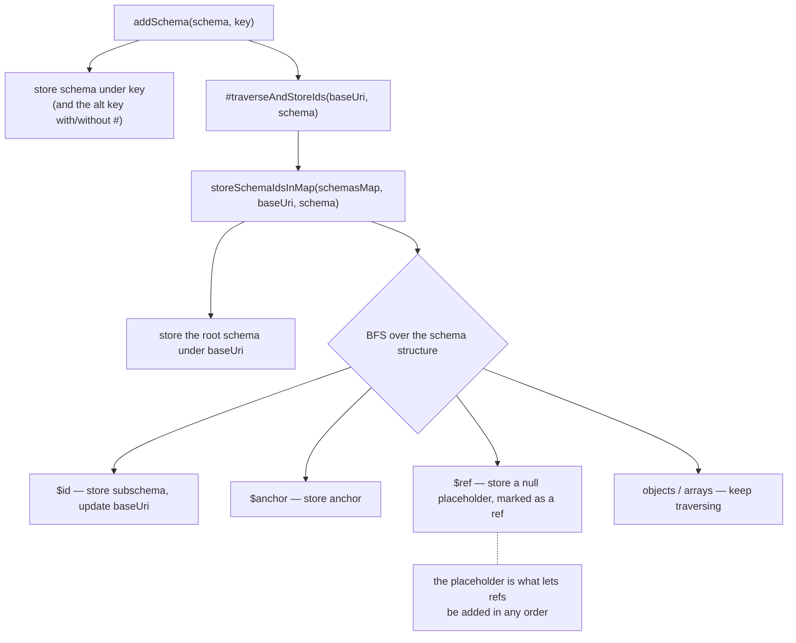

**Key Data Structure**: `#schemas Map<string, schema|null>`

- Keys are normalized URIs (e.g., `http://example.com/schema#`, `#/$defs/foo`)
- Values are either the schema object or `null` (for refs that point elsewhere)
- Stored at `JarenValidator` instance level (survives multiple `compile()` calls)

**Important**: At this phase, refs are stored as `null` placeholders. The actual resolution happens later.

**The document held is the one the compile reads** (`#heldDocument`): a
relative root `$id` is resolved once against the key (the `origin` without
one), and a root that declares no identifier is given the key as its `$id`,
so every later step, which reads a document's base from its root identifier,
reads it as the same document compiled with that `$id`. Either way a shallow
copy is held; `#originals` maps it back, so `getSchema` answers the caller's
object. A fragment-only root `$id` is resolved the same way; a root draft-04
`id` is kept. `compile` reads a root `$id` with a fragment (`#root`, `…/r.json#root`)
as naming the document too: `#traverseSchema` also registers the document
under the URI before the fragment, where no other schema the validator holds
has it, so its pointers resolve as under a key; `#traverseSchema` then
compiles it under that URI (`…/r.json#`), and `#precompileRefs` builds a plain
name of a document held under the same URI once, under the URI, naming the
name by that object (`aliasObject`). An identifier holding a fragment has no
second spelling: only a document's URI is held with and without its empty
fragment (`storeSchemaIdsInMap`). `addSchema` holds a document whose root
`$id` holds a plain name and that is not held under the URI before it
(`#underOwnName`) as a copy whose same-document references are spelled below
the name (`#` as `…#root`, `#/definitions/s` as `…#root/definitions/s`,
`underOwnName` in traverse.js), and records the copy in `places.rooted`;
`pointerStart` reads where the pointer of such an id begins, so `placeAt`,
`pointerBase`, `unwalkedReading` and `resolveRefSchemaShallow` read it from
that document whatever is held under its URI. Only the references the copy
rewrote (`places.ownRefs`, per object and keyword) read such an id: any other
`$ref` or `$dynamicRef` spelling one (`…#root/definitions/s`, a plain name
nothing declares) is refused `JK0009` where it is compiled or followed as a
hop (`spellsHeldPlace`, `ValidationRoot#refuseHeldPlace`); a `$recursiveRef:
"#"` there names the document by its name (`heldNameOf`). A
draft-07 `$ref` beside an `$id` resolves against the base the walk recorded
for it (`keptRefBase`), not the base the object happens to be built under: a
held document's root is built from another document's compile.

A place the walk refuses does not end the registration: `addSchema` passes
`storeSchemaIdsInMap` an `onFault` that takes the refusal, and the walk goes
on (a `$ref` that is no URI registers no target; an `$id` that is no URI, or
an identifier an earlier place declares, registers nothing at or below its
place). The compile and loader walks pass none, so the refusal is thrown
there, coded: an identifier declared twice is `JK0012`, naming the first
place (the walk keeps where it registered each one). Where anchors are not
allowed an `$anchor` or `$dynamicAnchor` registers nothing. A plain-name
fragment (`#a b`, `#_a`) is keyed as the URI spells it,
so an anchor and a reference to it meet whatever characters the name holds; a
fragment that decodes to `/…` is a pointer, its `%2F`s read as `/`s
(`parseJsonPointer`), so every later per-token decode stays the only one. An
anchor spelled as a pointer registers nothing (it would shadow the place the
pointer names); the walk records it in `places.unread`, as it records a
draft-04 `id` it does not read, so the `JK0009` for a reference to either
names it and the repair. An identifier whose fragment is spelled as a pointer
is read without that fragment, by one function, `identifierText`
(schema-keywords.js), in this walk, `identifierOf`, `indexSchemaResources`,
`#withResolvedRootId` and `#heldDocument`; the walk records the fragment in
`places.unread` too, and a root `$id` that is nothing else reads as none.
Which keyword identifies a schema object — `$id`,
or `id` where the document declares no known draft — is one function,
`identifierKeyword` (schema-keywords.js), read by this walk, by
`indexSchemaResources` (references.js: the resource index the normalizer, emit
and the strict profile resolve references through) and, through `identifierOf` (traverse.js), by every place the
compile derives a base or a location from an identifier: the compiled object,
a child's location, a pointer's descent, the loop check and the precompile of
registered documents. A
blank `$ref` or `$dynamicRef` counts as a reference (`hasSchemaReference`)
and resolves as `#` (`schemaReference`), the current resource, never against
a base that carries a pointer fragment.
`#assertNoRefLoops` then refuses a loop of pure references only when both
readings of a document that declares no draft make it (`resolveRefSchemaDeep`
with no draft and with draft-07): a loop one reading makes is refused by the
compile that reads it so. It does not run for a document whose walk refused a
place, or that holds a blank `$ref` (read as none before it was the empty
reference): such a document does not compile as a whole, so a loop in it is
left to the compile that reaches it, and what else it holds answers.

### Phase 2: Schema Traversal

**Purpose**: Create a schemas map for a specific compilation, merging instance schemas with passed schemas.

**Entry Point**: `JarenValidator.compile(schema, schemas)`

**Flow**:
```
compile(schema, schemas)
  └── #traverseSchema(schema, schemas, instanceSchemas)
        ├── Create new schemaMap from instanceSchemas
        ├── storeSchemaIdsInMap(schemaMap, origin, schema)
        ├── (Optional) storeSchemaIdsInMap for additional schemas
        └── restoreSchemaRefsInMap(schemaMap)
              └── For each null entry:
                    ├── Try resolveRefSchemaDeep (flatten chains)
                    └── On failure: resolveRefSchemaShallow (single hop)
```

**Key Data Structure**: `schemaMap Map<string, schema>` (local to this compilation)

- Merges instance-level schemas (`this.#schemas`) with compile-time schemas
- After `restoreSchemaRefsInMap`, all ref values are resolved schemas (not null)
- **Ref chains are flattened**: `A → B → C` becomes `A → C`
- **A chain that comes back to an id it visited is a loop** that never reads the instance (a hop's id is the place it names, spelled from the last resource its pointer enters: `resolveRefSchemaShallow` names a place below an identifier by the identifier's URI and the rest of the pointer, and a fragment-only `$id` starts no resource); `resolveRefSchemaDeep` throws a `RefCycleError` (`SchemaCompileError`, `JK0001`, `src/errors.js`) naming it (`A -> B -> A`, or `A refers to itself`), and the compile paths that tolerate a not-yet-resolvable target rethrow it
- **A root that comes back to itself before reading the instance** is the same refusal: `assertRootReadsInstance` follows, from the compiled root, each `$ref` and the one in-place applicator a schema evaluates first on every instance (`firstInPlaceSubschema`), and throws when the walk returns to a schema already on it. It runs once the compilation's options are known: whether a keyword beside the applicator can fail an instance (`canFail`) is read from `REF_SIBLING_KEYWORDS`, the list a `$ref` reads its asserting siblings from, narrowed by what compiles to no validator under those options (`format` without an asserting compiler, the content keywords without content validation, a subschema keyword holding `true` or `{}`). A `$dynamicRef` or `$recursiveRef` its place's draft defines (`admitsDynamicReference`, reading the `drafts` the walks record) is followed while the walk stays in the root resource; elsewhere it is an unknown keyword the walk passes over. A loop only some instances reach is left to the reference depth bound below
- **Validation nests the references it enters at most `maxReferenceDepth` (default `REFERENCE_DEPTH_CEILING`, 256) levels deep.** Each wrapped reference compares the one shared count with its own compilation's option (`JK0002` refuses an option that is not a positive safe integer). Every loop through compiled closures contains a reference resolved when first used (a target still under construction cannot be captured eagerly) or a dynamic reference, so `boundReference` wraps exactly those — the lazy `$ref` resolver, `$dynamicRef` and `$recursiveRef` — with one count for the process (`openReferences`, errors.js), which each reference raises on entering and lowers by assignment in a `finally`: while the host's stack is full a call throws again, so a restore that calls would leave the count raised for the rest of the process. Each adds its weight, the levels it nests per entry, read when it compiles (`ValidationRoot#referenceWeight`): where its target is under construction (`#building`, which holds each path with its schema, so a dynamic reference's initial target named by an anchor is found too), the objects between that target and the one holding the reference; else 1. Past the bound it throws `SchemaRuntimeError` `JK2001` (naming the references while each weighed one, the levels else): thrown, never folded into `false`, because `not` would invert a folded failure. A reference to a target already built calls the target directly and costs nothing, so a loop closed through one (two definitions referencing each other where the compile did not build the second inside the first) counts one per turn, whatever levels a turn nests, and the host's stack can give out before the count does. The outermost counted reference on the stack — the one entered with no other counted, and the only frame that holds a handler, since a `catch` costs every frame stack — then catches the host's refusal where the stack has unwound and throws `JK2001` in its place (`referenceUnwound`: the host's error is its `cause`, told from any other error by `isStackExhausted` of `@jarenjs/core/object`); the references below it call nothing on the way out. The state a validation moves on its way down is restored the same way, by assignment and never by a call: the dynamic scope and the open branch walks to what the frame read on entering (`ValidationRoot#dynamicScope`, `ValidationRoot#branchWalks`), the `undefinedElement` flag. The normalizer wraps the references that close its loops with the same `boundReference` and count, at its own `maxReferenceDepth`
- **A compile nests at most `maxSchemaDepth` (default `SCHEMA_DEPTH_CEILING`, 128) subschemas.** Every subschema the compile builds is a `ValidationObject` constructed inside its parent's constructor, so the paths under construction (`#building`) are the levels on the host's stack: `#createObject` refuses the next level past the bound with `SchemaCompileError` `JK0017` (`JK0002` refuses an option that is not a positive safe integer). The walks that read a whole subtree before or while it compiles keep their own stack instead (`#walkKeywords`, `passesEverything`, the registration walk), so a document nested deeper reaches the bound rather than overflowing first, and data nested in a keyword's value (`const`, `default`, an unknown keyword) is walked at any depth. The readers' walks ahead of a normalizer's compile keep their own stack too (the placement of `indexSchemaResources`, the reading of `withoutUnreadVocabularies`, run as generators on one stack), and the normalizer's compile holds the same bound (`compileNode`)

**The Critical Optimization**: `restoreSchemaRefsInMap` now uses `resolveRefSchemaDeep` instead of `resolveRefSchemaShallow`. This follows the entire ref chain at load time and stores the final schema directly.

### Phase 3: Compilation

**Purpose**: Create compiled validator functions from schemas.

**Entry Point**: `JarenValidator.#compileSchemaWithRoot(...)`

**Flow**:
```
compile()
  ├── Create ValidationRoot(origin, schemaMap, formats, options)
  ├── #precompileRefs(root, schemaMap, origin, places, held, reached)
  │     └── For each ref in schemaMap:
  │           ├── Skip a schema the validator holds that this compile does not reach
  │           ├── Skip if already compiled
  │           ├── An $id's URI without the empty fragment: name the object built under "#"
  │           ├── A pointer to a pure $ref hop: build the hop, not the flattened end
  │           └── root.createObject(id, schema, origin)
  │                 └── ValidationObject(root, id, schema, baseUri)
  │                       └── compileValidator() → returns validator function
  └── Return jarenValidateSchema(data) function
```

**Key Classes**:

#### ValidationRoot
- Manages the `Map<string, ValidationObject>` called `#objects`
- Entry point: `validate(data)` clears errors and calls `#firstSchema.validate(data, data)`
- Creates objects via `createObject()` and caches them in `#objects`
- **Pre-compilation**: Now creates ValidationObjects for ALL refs before returning

#### ValidationObject
- Represents a single schema location (identified by URI)
- **Constructor**: Immediately compiles validator via `compileValidator()`
- **Key property**: `#validator` - the compiled function that validates data
- For refs: `#validator` is the target validator function (direct reference)

**The Critical Optimization**: `#precompileRefs()` iterates through `schemaMap` and creates `ValidationObject` instances for every ref the compile reaches. This moves object creation from validation-time to compile-time. The compile's own entries are all built; of the schemas the validator holds, only the entries `reachedKeys` (traverse.js) names (see *Reference Resolution System*), so a compile costs what its schema and its references cost, not what the validator holds. A canonical relative `$id`, and the identifiers on the way to a pointer's place, are read against the base the registration walk recorded for their object (`places.idBases`), which is the base a compile of the whole document reads them against. The map holds a chain's end under each pointer to a pure `$ref` hop (`isReferenceHop`); the object under such a pointer is built from the hop itself, so its reference reaches the end under the end's own id, read at the end's place — under the draft that place declares and against its own base — as a `$ref` straight to it reads it. The output formats name each hop from these objects.

### Phase 4: Validation

**Purpose**: Validate data against compiled schema.

**Entry Point**: `jarenValidateSchema(data)`

**Flow**:
```
jarenValidateSchema(data)
  └── root.validate(data)
        └── #firstSchema.validate(data, dataRoot)
              └── this.#validator(data, dataRoot)
                    └── Either:
                          ├── compileSchemaObject() result (for non-ref schemas)
                          └── Target validator function (for refs, pre-compiled)
```

**Key Insight**: For refs, `this.#validator` is **already** the target validator function (set during Phase 3 pre-compilation). No resolution happens at validation time.

---

## High-Level Architecture

```mermaid
flowchart TB
    subgraph "Public API Layer"
        A[JarenValidator]
        B[ValidationOptions]
        C[ValidatorOptions]
    end

    subgraph "Compilation Layer"
        D[ValidationRoot]
        E[ValidationObject]
        F[Schema Compilation]
    end

    subgraph "Schema Processing"
        G[Schema Traversal]
        H[Reference Resolution]
        I[JSON Pointer Handling]
    end

    subgraph "Keyword Compilers"
        J[Type Validators]
        K[String Keywords]
        L[Number Keywords]
        M[Array Keywords]
        N[Object Keywords]
        O[Combine Keywords]
        P[Conditional Keywords]
    end

    subgraph "Runtime Dependencies"
        Q[@jarenjs/core]
    end

    A --> D
    D --> E
    E --> F
    F --> J & K & L & M & N & O & P
    G --> H
    H --> I
    D --> G
    J & K & L & M & N & O & P --> Q
```

---

## Module Organization

```mermaid
flowchart LR
    subgraph "Entry Point"
        INDEX[index.js]
    end

    subgraph "Core Classes"
        INDEX --> VR[ValidationRoot]
        INDEX --> VO[ValidationObject]
        INDEX --> JV[JarenValidator]
    end

    subgraph "Schema Compilation"
        VO --> SCHEMA[schema.js]
        SCHEMA --> TYPE[type validation]
        SCHEMA --> COMPILE[compileSchemaObject]
    end

    subgraph "Keyword Modules"
        SCHEMA --> STRING[string.js]
        SCHEMA --> NUMBER[number.js]
        SCHEMA --> BIGINT[bigint.js]
        SCHEMA --> ARRAY[array.js]
        SCHEMA --> OBJECT[object.js]
        SCHEMA --> COMBINE[combine.js]
        SCHEMA --> CONDITION[condition.js]
        SCHEMA --> PROPDEP[property-dependencies.js]
        SCHEMA --> ENUM[enum.js]
        SCHEMA --> FORMAT[format.js]
        SCHEMA --> CONTENT[content.js]
        SCHEMA --> DATA[data.js]
        SCHEMA --> DDLR[dollar-data.js]
        SCHEMA --> UNEVAL[unevaluated.js]
    end

    subgraph "Infrastructure"
        INDEX --> TRAVERSE[traverse.js]
        INDEX --> TOOLS[tools.js]
        INDEX --> DYNREF[dynamic-ref.js]
        OUTPUT[output.js subpath] -.-> VR
    end

    subgraph "External Dependencies"
        TOOLS --> CORE[@jarenjs/core]
    end
```

---

## Core Classes

### JarenValidator

The primary entry point for consumers. Manages schema registration, format registration, and orchestrates the compilation process.

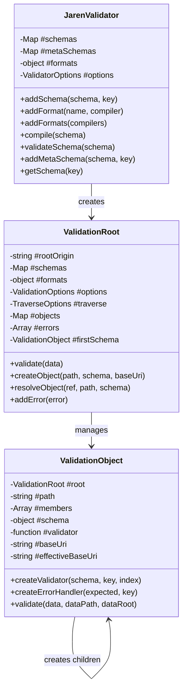

### ValidationRoot

The compilation context that:
- Maintains the schema registry (URI → Schema mapping)
- Manages format validators
- Houses all compiled ValidationObjects
- Collects validation errors
- Provides `$ref` resolution services

**Owner threading**: the constructor takes a sixth argument `owner`
(default `null`), exposed through an `owner` getter, and both construction
sites in `index.js` pass the owning `JarenValidator` for it. This lets
`query-keyword.js` hand that instance to `createTypeTestCompiler`, so the
schema literals inside a `$query` document (`$valid`/`$assert`/`$as`)
resolve their `$ref`s against the owner's `addSchema` registrations. The
resulting ESM cycle — `index.js` → `schema.js` → `query-keyword.js` →
`query.js` → `index.js` — is benign: `query.js` only *reads* the hoisted
`JarenValidator` declaration at call time, never at module-evaluation time.

**Vocabularies per place**: the walk records, for each schema object, the
nearest `$schema` on the way to it in its own document (`places.dialectUris`),
and the constructor's seventh argument reads what that dialect switches on
(`dialectVocabularies`: the validation vocabulary and format assertion as its
meta-schema's `$vocabulary` declares them, read by `dialectVocabulary`
(schema-keywords.js) where that member is a keyword of the meta-schema itself
— of 2019-09 on, or under no `$schema` of its own — and the format and
content assertions its draft defaults). `optionsAt(path, schema)` hands each `ValidationObject` the
compilation's options with that dialect's switches — one `ValidationOptions`
per dialect URI, made once — so a held document reads alike compiled
directly and through a `$ref`, and a place under no `$schema` reads the
compilation's. A reference target is compiled under the draft its place
declares (`placeDraft`); one no walk recorded — below a keyword no draft
defines — reads the nearest `$schema` on the way to it in its document, or
the nearest recorded place's draft (`unwalkedReading`), as the normalizer's
index places it, and `optionsAt` reads its vocabularies by the dialect that
same reading names, so it answers as the same subschema under `$defs`. A
dialect whose meta-schema (of 2019-09 on) requires a
vocabulary this package does not implement is refused there, the root's
place included, `JK0016` (`unimplementedVocabulary`, errors.js); a place no
walk recorded is refused under such a dialect as a recorded one is.
`addMetaSchema` passes none: a meta-schema compiles under the validator's
options everywhere. The readers handed a validator as `dialects` read the
same switches through `withoutUnreadVocabularies` (normalize.js): the
document they read drops the validation keywords where the dialect governing
a place leaves that vocabulary out (`VALIDATION_KEYWORDS`), and refuses
`JK0016` alike.

### ValidationObject

Represents a single schema location with its compiled validator:
- **Identity**: URI path identifying this schema object
- **State**: The schema definition and compiled validator function
- **Relationships**: Parent root reference, child members
- **Behavior**: Creates child validators, handles error generation

---

## Compilation Pipeline

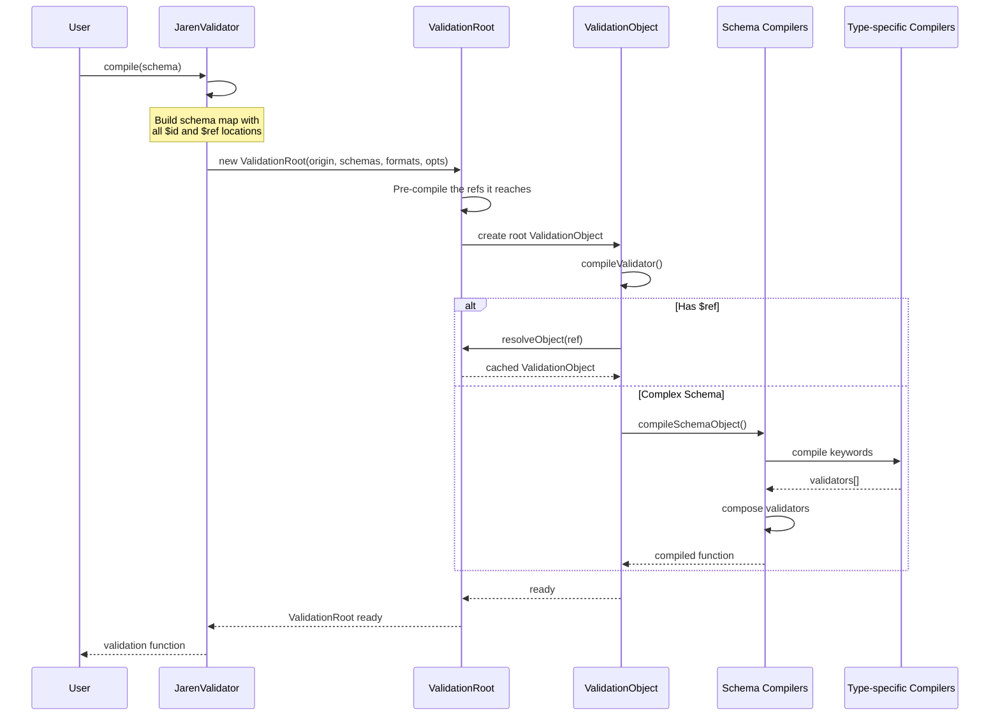

---

## Schema Compilation Flow

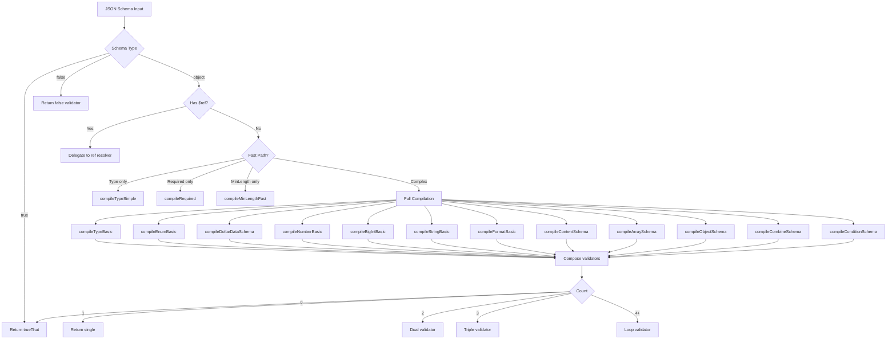

---

## Keyword Compiler Architecture

Each keyword module follows a consistent pattern:

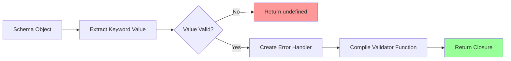

### Example: String Keyword Compilation

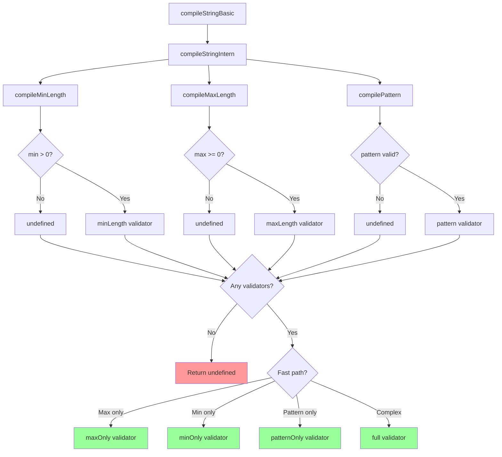

---

## Reference Resolution System

The `$ref` resolution is one of the most critical performance optimizations. Rather than resolving references at validation time, the references a compile reaches are pre-compiled:

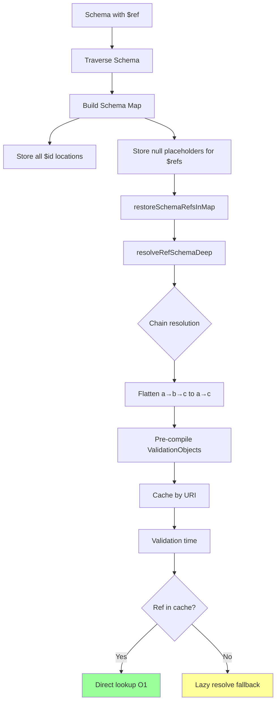

### What a Compile Reaches

A compile copies the validator's schema map and walks its own schema into the
copy; it then resolves and builds its own entries, and, of the schemas the
validator holds, only what it reaches (`reachedKeys`, traverse.js):

- **Recorded at registration.** The walk (`storeSchemaIdsInMap`) records, for
  each object holding `$ref`, `$dynamicRef` or `$recursiveRef`, the place of
  its `$ref` and the targets a compile that builds the object asks for, read
  against the base its identifier sets and against the one it leaves, so both
  readings of an undeclared document are covered (`places.refs`; a compile's
  own documents record into a map of that compile); and, for each identified
  object, the base its identifier was read against (`places.idBases`). An
  object read twice (one `$ref` object held at two places, or in two
  documents) keeps its record where both readings ask for the same targets;
  where they differ its references are not known.
  Every schema object a walk reads has an entry in `places.refs`, so a
  place a walk read is told from one no walk entered. `addMetaSchema`
  records the same, so a held meta-schema is read like any registered
  document. Where a walk leaves part of a place unread that a compile may
  read — a place declaring an identifier a second time, a
  `propertyDependencies` it does not read as a keyword — and a
  reference-shaped object lies in that part, the place's entry is `null`:
  its references are not known.
- **Walked when named.** A target no walk read lies below a keyword no draft
  defines (an operation's schema in a contract document, a member of
  `components/schemas`). The compile that first reaches it walks it then:
  `storeSchemaIdsInMap` under the id that names it, under the compile's
  traversal options and from no declared draft, into maps of that one read,
  so nothing is registered. What its references ask for is read from that
  walk and kept per id. The walk answers only where the compile is known to
  ask the same: the place declares no identifier (no walk registered one,
  and the build reads it by what it has built), and the base its key builds
  it against (`pointerBase`, which the build shares) is its document's. Below
  a place a walk read, a reference-shaped object without an entry is no
  reference of that place — data, or below such a keyword — and is passed
  over; a compile's own documents are read strictly, and such an object in
  them makes the compile read everything.
- **Collected per compile.** One descent of the documents the compile was
  handed, then what each target reaches, gives the keys and targets it
  reaches, each with the place of the `$ref` naming it. `restoreSchemaRefsInMap`
  resolves the `null` placeholders among them, in map order, and leaves the
  others `null`, which every lookup reads as not held; a held reference
  nothing resolves is thus refused by the compile that reaches it, when it
  compiles, at that place.
- **Kept per held set.** `places.kept` holds, until the next `addSchema` or
  `addMetaSchema`, the object each held key names, the keys naming each
  object, what each place reaches next (per object a walk read, per id for
  a place walked when named), what is built above each held object, what
  builds each target when it compiles, what every compile reaches, and the
  features of the held schemas with the objects that scan read (a compile
  scans only what it added: its own entries, and the targets it restored,
  without the held objects below them). What builds what is read from the
  held set alone, when the first compile after a registration reads every
  held key and every target an item reference names; none of it depends on
  the compiles before. Resolution itself stays per compile, under that
  compile's reading.
- **Built in the same order.** A reference to a schema already built is
  called directly; one to a schema not built yet is resolved on first use,
  and counts toward the depth bound (`JK2001`). So what is built, and when,
  must not change with what a compile leaves out. The keys naming a
  registered object that brings a reached one into being are therefore built
  too, without what else that object reaches: the object around it (a place
  is built as a member of the document around it, at that document's turn),
  one holding a lone `$ref` to it at an item position (the item shortcut
  builds the end of the chain such a reference starts when its holder
  compiles), and one that is itself a `$ref` to it (a link of such a chain).
  Such a reference may build a place no key names, which builds the next at
  once: that place is followed by its id to the key that starts the chain.
  A held schema whose identifier is no URI reference is built by every
  compile, and the build refuses the first of them (`JK0010`), as it refused
  every compile. A held place whose references are not known is built by
  every compile that holds a reference (one that holds none calls nothing
  another build could have built first): what it builds at once is not
  known either. Entered without a place, it and what builds it do not
  refuse the compile with the failures a build passes on (a query literal
  that compiles its own document, a reference cycle); a key whose base
  cannot be read, one that crosses an identifier that is no URI reference,
  still refuses it (`JK0010`). Each then comes into being where a compile
  of everything built it.
- **The fallback.** A compile that reaches a place whose references are not
  known reads every held schema, as every compile did: a `$ref` that is no
  URI reference; a `$ref` object read at two places whose bases give it two
  targets; a place a walk left partly unread with a reference in that part;
  a place walked when named that declares an identifier, or lies under one
  setting another base than its document's; and, in the compile's own
  documents, a reference-shaped object its walk did not record.

### JSON Pointer Handling

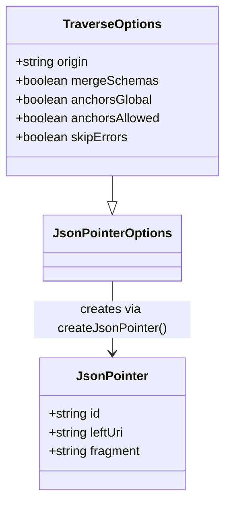

`leftUri` is the document's key: its URI as the URL standard spells it, the
query included (`a.json?v=1` and `a.json?v=2` are two documents), with an
empty fragment. A pointer fragment a URI cannot decode (`#/a%b`, a `%` that
starts no escape) is no URI reference and is refused where it is parsed
(`JK0010`).

---

## Data Reference Systems

The validator implements two complementary data reference mechanisms:

```mermaid
flowchart TB
    subgraph "$data Keyword Ajv-style"
        A1[Relative JSON Pointer] --> A2[resolveRelativePointer]
        A2 --> A3[Access parent/ancestor data]
        A3 --> A4[Dynamic constraint values]
        A4 --> A5[Example: maximum: {$data: '1/larger'}]
    end

    subgraph "data Keyword json-everything-style"
        B1[JSON Pointer Path] --> B2[resolveDataRef]
        B2 --> B3[Access from data root]
        B3 --> B4[Cross-property validation]
        B4 --> B5[Example: data: {minimum: '/A'}]
    end

    A5 --> C[Runtime value resolution]
    B5 --> C
```

**Compile failure**: the ref compiler of `@jarenjs/json` (`compileDataRef`,
which both keywords call) *throws* on a malformed reference, and both keywords
let the error out: the schema fails to compile. A reference that compiles but
finds no value in the instance asserts nothing.

**One grammar option, three readers.** The `relativePointerDialect` validation
option (`'handrews-01'`, the default, or `'bhutton-00'`, which adds index
manipulation such as `0+1`) reaches `compileDataRef` as its `{ dialect }`
through `dataRefOptions(schemaObj)` in `tools.js`, which the shared keyword
compilers and the `$data`-only `uniqueItems` and `required` all read, and
reaches the `relative-json-pointer` format compiler of `@jarenjs/formats`
through `schemaObj.options`. The format a `data` keyword names at run time is
compiled against a stand-in validation object that carries the same dialect.
`ValidationRoot` refuses any other spelling with a `TypeError` when a schema
compiles, so a misspelling is not a silent fallback to the default.

**Locations are built where something reads them.** A relative `$data`
reference, the `data` keyword and `$query`'s `path` external all read the
location of the instance they sit on, and a location is a string built per
member and per item. While the validator stops at the first failure
(`skipErrors`, the default unless errors are collected), `ValidationRoot` scans
the schemas once: with no reader anywhere, no location is built at all. With
one, each object and array schema asks `childLocationsNeeded` about the
subschemas its members and items are validated against, and extends the
location for them only when that subtree holds a reader or reaches one through
a reference. A `$ref` is resolved while the schema compiles and its target is
judged the same way, so a subtree whose references lead only to schemas
without a reader extends nothing. A `$dynamicRef` or `$recursiveRef` (whose
target the instance decides), a `$ref` that does not resolve, and a `$ref` in
a subtree holding an embedded `$id` (which moves the base it resolves against)
count as reaching one. A subtree that reaches no reader is handed its parent's
location unextended and never looks at it. A validator that continues past failures (`skipErrors: false`, which
collecting errors implies by default) always extends: its errors report the
location.

---

## Error Handling Architecture

```mermaid
flowchart LR
    A[Validation Failure] --> B{skipErrors?}

    B -->|true| C[Return false only]
    B -->|false| D[Create InternalValidationError]

    D --> E[Store in ValidationRoot.errors]
    E --> F[Continue validation]

    F --> G[All validators complete]
    G --> H{collectErrors?}

    H -->|true| I[convertInternalErrors - messages.js,<br/>each distinct error once]
    H -->|false| J[Return boolean only]

    I --> K[Extract params, resolve msgid,<br/>match errorMessage registry,<br/>render through catalog]
    K --> L[Return {valid, errors}]

    style C fill:#9f9
    style J fill:#9f9
    style L fill:#9f9
```

A collect-mode validator also carries `narrow`, defined once per compile: it
calls the validator and returns its `{valid, errors}`, with the instance as
`value` on the valid branch, so the plain call's answer and cost are unchanged.

A collecting walk runs every branch of a `oneOf`, and the branches of an
`anyOf` up to a match, in full. Branches that enter the same definition on
the same member through references would enter it once per branch, at every
level below: a grammar of operator phrases over operand expressions grew
with the branches tried to the power of the nesting. While such a branch
walk is open, a reference resolved on first use that enters its target on a
member it entered before, at the same location with as many reference
levels open (whether a reference refuses, `JK2001`, depends on those
levels), gives that answer again and records the errors that entry left
(`ValidationRoot#callReference`). The answers are kept for one validation
and dropped when it returns. Recording output units, a kept answer also
gives again the units its entry recorded (`UnitRecorder#give`): a unit holds
its evaluation path segment from the unit that applied it, so the one
recorded subtree stands under every unit that entered it. A compilation
whose schemas hold an `unevaluated*` keyword (it reads the annotations an
entry leaves) or any dynamic-scope keyword (`$dynamicRef`, `$dynamicAnchor`,
`$recursiveRef`, `$recursiveAnchor`) walks in full.

The error list keeps each distinct error once, in the order of first
appearance. Most repeats are the same records given again by kept answers,
so the list keeps a record once where it is given: an entry that keeps its
answer opens a span of the list, a record given again into a span that holds
it already is not added, and when the entry returns the records the span
around it holds already leave the list. A span keeps every record its entry
raised or was given, the ones below it included, so the answer it keeps is
complete whatever a discard (`not`, `if`, `contains`, a matching `anyOf`, a
`oneOf` that matched) later takes from below it. Each record knows where it
lies highest in the list and where it was given again from, so these checks
read no list; a discard truncates the list as before and the places it
emptied are dropped when next read. The records left are converted once,
and an error the same in its public form as one before it (keyword,
instance location, schema location, params; two records of one keyword
raised again where no answer was kept, or named after two property names)
leaves both lists (`ValidationRoot#distinctErrors`). The legacy `errors`
getter reads the same records.

### Report-Time Messages (messages.js)

Conversion is structured-first, render-late (the normative spec is
[docs/ERROR-MESSAGES.md](./docs/ERROR-MESSAGES.md)):

- Every public `ValidationError` carries a stable `msgid` (the matched
  `errorMessage` spec's `$msgid`, else the `$query` runtime code, else the
  keyword) plus raw `params`; `instancePath` is a straight read of the
  first meta argument every handler call site passes (the
  handler-contract invariant), behind a charCode guard that yields `''`
  rather than ever a wrong path.
- The `errorMessage` keyword compiles at schema compile time into a
  registry on `ValidationRoot` (`registerErrorMessage`) — no validator
  closure is emitted and the single-keyword fast paths stay eligible (the
  key count excludes it). Matching happens only over the failed set:
  nearest registered ancestor by segment-aware prefix; map-form entries
  and `_` apply at the node itself, the string form covers the subtree.
- Human text renders through catalogs — plain objects of closures /
  template strings (`messagesEn` built in; packs in `@jarenjs/locales`).
  `localizeErrors(errors, catalog)` re-renders post hoc from
  `msgid` + `params`; the `messages: false` option skips rendering
  entirely (`message: ''`).

### Standard Output Formats (output.js)

The formats live in `output.js`, the `@jarenjs/validate/output` subpath; the
core never imports it, so a validator given no format ships none of it. A
format is an object the `outputFormat` option carries: `validator(root)`
builds the compiled function, and a recording format's `recorder(schemas)`
makes the compilation's recorder. The core keeps only the hooks, all decided
when a schema compiles (an unrecorded compilation builds the closures it
always built):

- **Every applied subschema enters the recorder.** Recording, each
  `ValidationObject` wraps its validator so that applying it calls
  `recorder.enter(object, …)`. The applicator that reached it marks the step
  first (`markStep` in `tools.js`): `createValidator` its keyword and index,
  the `$ref` sites `$ref`, the `$dynamicRef` and `$recursiveRef` keywords
  their own. `addError` hands every error to the recorder, which files it
  under the innermost open unit.
- **Nothing that would skip a unit.** Recording turns off the items `$ref`
  fast path (it calls the target in place of the item's subschema), the
  runtime caching of a resolved `$ref` target, the in-place `true` of
  `unevaluated*`, and the first-match `anyOf` (recording runs the
  annotation-tracking path, which evaluates every branch).
- **Projection, not bookkeeping.** `output.js` reads the finished tree:
  locations (a dynamic anchor's object, a plain-name fragment and a
  draft-06/07 plain-name `$id` are resolved to their JSON Pointer by walking the registered resources once),
  annotations from the schema and from the units each applicator applied,
  the survival rule (a passing unit inside passing units), the wrapper
  errors a failed subschema already explains, and the pruning of the flat
  and condensed forms. A unit's applied units are made from the records on
  first read, and `basic`, `detailed` and `list` read only the ones their
  pruning keeps: a failed branch under an applicator that passed (an `anyOf`
  branch, a `not` subschema), recorded once and given to every unit that
  entered it, is never expanded. `verbose` and `hierarchical` write every
  applied unit, so their size follows the branches. The recorder lets go of
  the tree once the run returns.
- **Each distinct error once, by projection.** `distinctBasicOutput`,
  `distinctDetailedOutput` and `distinctListOutput` record what their
  default twins record and project it through one `Distinct`: a failed
  child unit whose record was already expanded under an earlier path (a
  kept answer gives one record to every path that entered it) is not
  expanded again, which bounds the projection by the records rather than
  the paths; and a failed unit's error is dropped when one written before
  it in document order has the same absolute schema location, instance
  location, text and source errors' keywords and params (which also
  catches what a walk without kept answers raised twice). `basic` and
  `detailed` drop it before condensing, so branch units follow. Passing
  units are never touched, so a passing document answers byte for byte as
  the default does.
- **Texts are rendered once and kept renderable.** A unit's text joins the
  messages `convertInternalErrors` rendered (`joinErrorMessages`); each
  projection lists, as it builds the units, which object holds each text,
  its member name and the `ValidationError`s it joins, and `keepOutputTexts`
  files that list in a `WeakMap` under the returned document (one entry per
  validation, nothing enumerable on any unit). `localizeErrors(document,
  catalog)` walks the list: it localizes each text's errors by the
  collected errors' own rules and joins them again. A copy of the document
  is not in the map, so it re-renders nothing.

### Strict Structured-Output Profiles (strict-profile.js)

`relaxSchema`, `deriveStrictProfile` and `strictProfileSize` live in
`strict-profile.js`, the `@jarenjs/validate/strict-profile` subpath; the core
never imports it. It works on schema documents, not on compiled validators,
and uses the compile pipeline twice, as a client:

- **One walk over schema positions.** Both functions map a node's keywords
  through `mapPosition`, which descends only where a keyword holds a schema
  (`SCHEMA_VALUE_KEYWORDS`, `SCHEMA_LIST_KEYWORDS`, `SCHEMA_MAP_KEYWORDS` of
  `@jarenjs/core/schema`, plus `$defs`, `definitions` and `dependencies`), so
  a member named like a keyword and `enum`/`const`/`default` data are never
  rewritten. `relaxNode` is the one relaxation step: the build-time LLM
  profiles of `@jarenjs/json` (`scripts/lib/schema-profiles.js`) and every
  strict-profile node run through it.
- **Bundling by node identity.** An index walk records every schema node's
  `uri#pointer` and the draft it is read under, under the base the resource
  index (`indexSchemaResources`, the one `compileNormalizer` and
  `@jarenjs/emit` read) places it at; a node the original reads as its `$ref`
  alone (`readsRefAlone`) is profiled as that `$ref`, which resolves against
  the enclosing resource even where an `$id` beside it names its own. A
  `$ref` resolves with `resolveSchemaReference` inside the resource its URI
  names, and the target node gets one `$defs` name in the profile however many
  references reach it. The original's validator holds the schema under the
  base the index read it at, named by an `$id` of that base (none where its
  root `$ref` is read alone), so a resource embedded in it resolves there too.
- **The original's validator decides `null`.** Once every reference is
  bundled, each optional member's place is compiled as `{ $ref: place }` by a
  `JarenValidator` holding the schema and its references, and run on `null`;
  only a member it refuses is widened and recorded as a placeholder (a
  `WeakMap` from the profile's object node to the member names).
- **Carriers are marked by node identity.** A JSON-text carrier, a boxed
  carrier and an entries map are recorded in `WeakSet`s over the profile's
  nodes; `fromProfile`/`toProfile` parse, box or rebuild where they meet one.
  A distributed object is a synthetic node whose members remember every
  original place they stand for, so the `null` question (and the `enum`
  narrowing of a discriminating branch) is asked of each place.
- **The original's validator also judges the whole answer.** `fromProfile`
  reads a `null` at a member the original leaves optional as the member left
  out, whether its schema refuses `null` or admits it. Only where the
  original refuses the answer read so, and accepts it with the nulls its
  schemas admit, is the answer read again: with all of them, then without
  each in turn, keeping the ones whose loss the original refuses. The nulls
  are named by their place in the answer, so a reading is rebuilt, never
  patched, and its members keep the answer's order. That path costs one
  reading and one judgement per such null; the common path, one of each.
- **The original picks a value's union branch; the profile's validator finds
  an answer's.** Every profile node remembers the place of the original it
  stands for (`origins`): the place it was derived from, every place that
  declares a member several declare, the original's branch for an object
  copied into a branch. At an `anyOf`, `toProfile` asks the original at
  those places — compiled as `{ $ref: place }` on first use, as the `null`
  question is — and writes the value in the first branch that accepts it;
  filling a closed branch drops and nulls members, so the filled value says
  nothing of whose it was. `fromProfile` compiles each branch's place in the
  profile (registered under a private identifier, read as 2020-12) once and
  follows the branches the answer matches; where their readings differ, it
  is the first whose original accepts its own reading.
- **The empty map beside an array is paired once, at the lowest union.** A
  last walk over the finished profile settles each `anyOf` after the unions
  its branches reach through references and nested unions: one whose
  branches hold entries (whose original, compiled at their place, accepts
  `{}`) in one branch and an array in another is marked (`paired`), and
  gains the closed object with no members unless a branch already reaches
  one, so a union above a paired one gains none. At a paired union
  `toProfile` writes an empty object as `{}` and `fromProfile` drops the
  empty map's reading of `[]` while another reading is left. Every other
  union, and so every profile without the collision, is left byte for byte.
- **A derivation's cost is its places.** Each compile of the original
  (`{ $ref: place }`, cached per place) reads only what the place references,
  so a derivation costs one compile per place it asks; the two maps add the
  places they ask on first use and keep them. It is a build-time or start-up
  step whose result a host keeps.
- **A profile's size is one more walk, and a graph.** `strictProfileSize`
  counts over the same `mapPosition` walk — properties, definitions, `enum`
  values, the characters of names — and, on the way, summarizes the root and
  each definition as a body: the object levels its own text reaches and each
  reference in it with the levels entered where it stands. The bodies form
  the reference graph; its strongly connected components (Tarjan's, on an
  explicit stack, so a long chain of definitions recurses through nothing)
  are the loops of references, and they come out with the ones nothing leaves
  first. A body on no loop is the deepest of its own levels and its
  references' targets, already measured; a loop is walked path by path from
  each body a reference outside it names, entering no body twice — the
  longest simple path, which has no cheaper exact answer — within two fixed
  bounds (the loop's members, the entries walked). Past either, the loop is
  measured as every body once, end to end: an upper bound of any path, so the
  number is never too low and the measure always returns. No provider's cap
  is built in.

### Loading Referenced Schemas (load.js)

`compileAsync` lives in `load.js`, the `@jarenjs/validate/load` subpath; the
core never imports it. It reads what a validator holds through
`validator-state.js` (the registered schemas, the traversal options and what
the walks read at each place, set by the constructor) and changes nothing in
the compile pipeline:

- **One walk.** It finds the references with the walk that registers a
  schema, `storeSchemaIdsInMap`, whose optional `onReference` callback is
  offered each `$ref` target, and each `$dynamicRef` target its place's
  draft defines, with its location. The
  targets are reached when the walk ends, once every identifier of the
  document is registered, so a reference into the schema's own resources is
  never loaded. Every document is walked as `compile` reads it: a place that
  declares no draft under the draft the schema names, so a draft-07 compile
  loads what a draft-07 `$ref` beside an `$id` names, and the entries a
  registered undeclared document left for its 2019-09 reading
  (`lateTargets`) are not loaded for it. A failed load of a target only such
  a draft-07 reading in a loaded document names is no refusal (`needed`):
  `compile` resolves that reference on the call that reaches it and refuses
  it there, so the loader answers what `compile` answers over the documents
  it could load.
- **Rounds, in a fixed order.** The documents one round reaches are loaded
  at once; only when every one of them settled are they registered, walked
  and their failures judged, each in the order it was reached. A reference
  into a resource embedded in a document loaded beside it is so held, never
  loaded, and a failed load of a document that a document loaded beside it
  or after it embeds is no refusal: which load settles first changes
  nothing.
- **Loaded documents are registered by `addSchema`** under the URI they were
  loaded from, and walked with that URI as their base (and named by it where
  their root declares no identifier). A schema the
  validator held before the call is not walked again: its unresolved
  references are already in the registry as `null` entries, and the
  documents they name are loaded too.
- **Then `compile`.** Nothing is compiled until every document is held, so
  the compiled validator is the synchronous one over the same registrations.

### Error Handler Creation

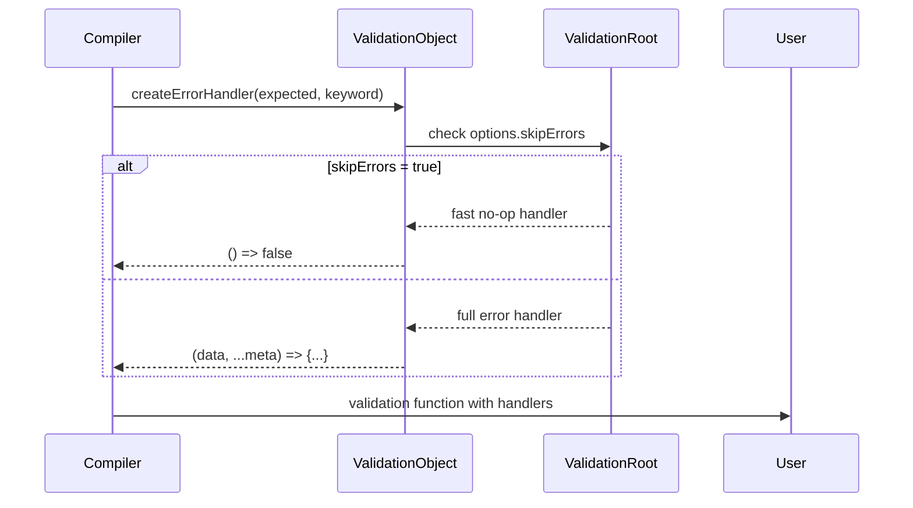

---

## Performance Optimizations

### 1. Fast Path Specialization

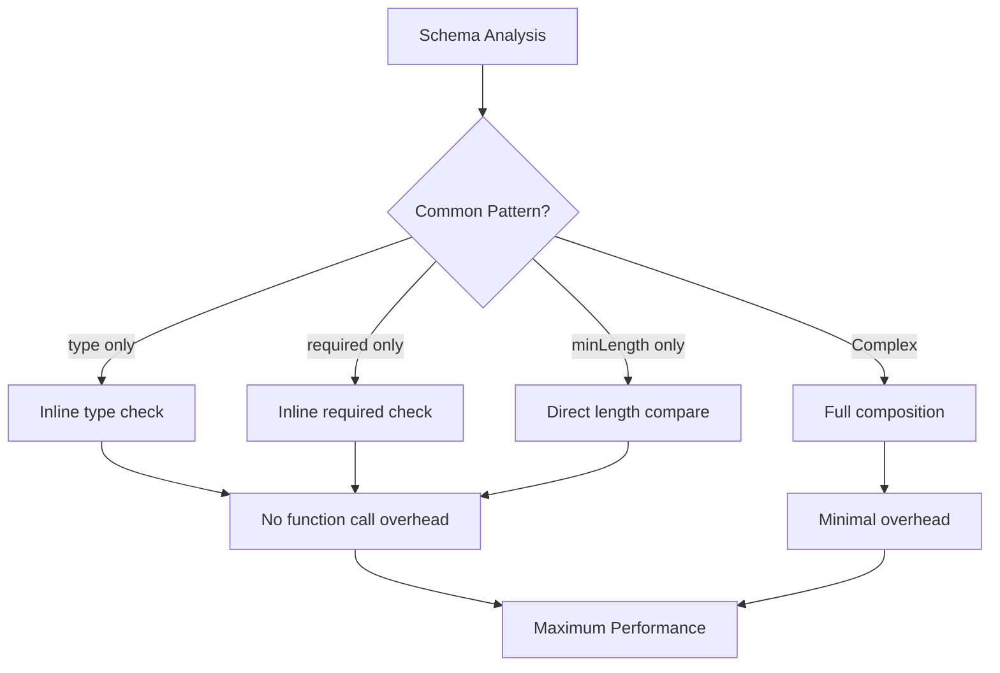

The fast paths and the general path share their type tests: `isNumberInstance`,
`Array.isArray` and `isObjectInstance` (`packages/validate/src/tools.js`) answer
`type` on every path (alone, beside a keyword, in a list, with `nullable`, for an
item, for a member) and are the instance test of every array and object keyword
group, so a value JSON cannot carry is read one way; the member tests
(`typeOnlyTest`) and the item tests (`array.js`) differ only on `undefined`.

### 2. Validator Composition Strategies

Based on the number of validators, different composition strategies are used:

| Validator Count | Strategy | Implementation |
|-----------------|----------|----------------|
| 0 | No-op | `trueThat` |
| 1 | Direct | Return validator directly |
| 2 | Unrolled | `return v1(data) && v2(data)` |
| 3 | Unrolled | `return v1(data) && v2(data) && v3(data)` |
| 4+ | Loop | `for (let i = 0; i < n; i++)` |

Every closure a schema passes through is shared by every schema of its kind,
so each one between the entry and the check that answers is a call that sees
every schema's children. In the first-failure mode, a single `type` name
first among the groups is tested by the combining closure itself (two and
three groups), or, when it names `object`, `string` or `array` and the group
of that kind comes next, by that group's own instance test, which is the
type's predicate (`isObjectInstance`, `isStringType`, `Array.isArray`): the object
group, the string keywords (`minLength`, `maxLength`, `pattern`) and a lone
homogeneous `items` walk report the type fault themselves; a lone
`items`/`prefixItems` walk, a lone bound or `multipleOf`, and a lone
`uniqueItems` (`validateUniqueItemsAlone`) test their own instance type
instead of sitting inside a guarding wrapper; the element walk
calls a tuple position directly; a tuple whose every position compiles to a
constant answer or a type-only test (a boolean schema, one asserting
nothing, a lone single-name `type`), with a boolean or absent keyword past
them and no annotation kept, is tested by code (`isPurePosition`) with no
call per element, and reads no element past its positions; homogeneous
`items` of one such test, where no annotation is kept and no item location
is read, are tested by the same code, every element read;
a type-only schema compiles to one test per type name that every such
schema shares (`typeOnlyTest`), so a member walk tells it, and a schema
asserting nothing, apart by identity and tests the member by code
(`isPureMember`); `properties` with `required`, alone or with
`additionalProperties` and nothing else where no annotation is kept and no
member location is read, is one closure (`compilePropertiesWalk`): with
`additionalProperties` it walks the instance's keys in their order, as the
general walk does, matching a key at the schema's next position without its
map; and a reference resolved on first use counts toward the depth bound in
its own closure, calling its target directly once it is known.

### 3. Compile-Time Readings Kept

A compile reads the same text many times over, so it keeps what it read:

- **Pointer parses, per compile.** `JarenValidator#compile` runs inside
  `withParsedPointers`: every `createJsonPointer` parse of a reference against
  a base, under one set of anchor options, is made once and handed out as a
  copy until the compile returns. A refusal is never kept.
- **Dialect URIs, bounded.** `officialUri` and the keys `heldDialect` looks a
  `$schema` up by are pure readings of a URI; the readings of the short URIs
  read lately are kept, a bounded number of them.
- **One build per `$id` document.** The schema map holds an `$id`'s URI with
  and without the empty fragment (`…/s.json#`, `…/s.json`); `#precompileRefs`
  builds the document under the `#` spelling only and names that object under
  the other key too (`ValidationRoot#aliasObject`), so a reference spelled
  either way reaches one object, and the locations below it.
- **No `$data` pass where nothing reads one.** A compilation in which no schema
  reads an instance location (`ValidationRoot#usesDollarData`) holds no `$data`
  member, so `compileDollarDataSchema` returns at once.
- **No discarded refusal in the items shortcut.** The `$ref`-only item
  shortcut resolves tentatively (`resolveObject(…, tentative)`): a reference
  naming a document the validator holds no schema under answers `null`, and
  the item is compiled in full, without building a `JK0009` only to discard it.

### 4. String Length Optimization

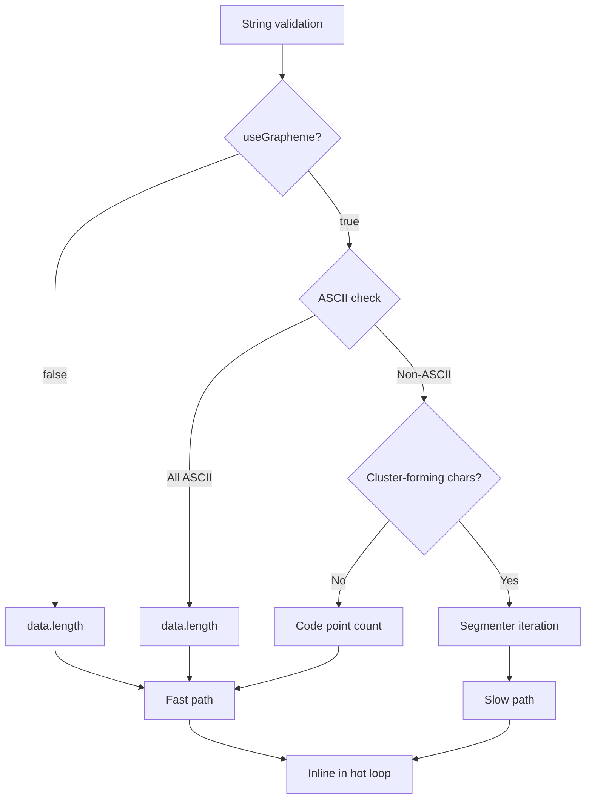

---

## Module Dependencies

```mermaid
flowchart TB
    subgraph "@jarenjs/validate"
        direction TB
        INDEX[index.js]
        SCHEMA[schema.js]

        subgraph "Type Compilers"
            STR[string.js]
            NUM[number.js]
            BINT[bigint.js]
            ARR[array.js]
            OBJ[object.js]
        end

        subgraph "Logic Compilers"
            COMB[combine.js]
            COND[condition.js]
            PDEP[property-dependencies.js]
            ENUM[enum.js]
        end

        subgraph "Content Compilers"
            FMT[format.js]
            CONT[content.js]
        end

        subgraph "Data Reference"
            DATA[data.js]
            DDLR[dollar-data.js]
        end

        subgraph "Infrastructure"
            TRAV[traverse.js]
            TOOLS[tools.js]
        end
    end

    subgraph "@jarenjs/core"
        CORE[index.js]
        CORE_NUM[number.js]
        CORE_STR[string.js]
        CORE_ARR[array.js]
        CORE_OBJ[object.js]
        CORE_FN[function.js]
        CORE_TXT[text/index.js]
    end

    subgraph "@jarenjs/json"
        CORE_JSON[index.js]
    end

    INDEX --> SCHEMA & TRAV & TOOLS & FMT
    SCHEMA --> STR & NUM & BINT & ARR & OBJ & COMB & COND & ENUM & CONT & DATA & DDLR

    INDEX --> CORE
    SCHEMA --> CORE
    STR --> CORE_STR & CORE_FN
    NUM --> CORE_NUM & CORE_FN
    BINT --> CORE_NUM & CORE_FN
    ARR --> CORE_ARR & CORE_OBJ & CORE_FN
    OBJ --> CORE_OBJ & CORE_ARR & CORE_FN
    ENUM --> CORE_OBJ
    CONT --> CORE_TXT & CORE_JSON
    DATA --> CORE_JSON
    DDLR --> CORE_JSON
    TOOLS --> CORE & CORE_STR & CORE_ARR
    TRAV --> CORE & CORE_NUM & CORE_STR & CORE_TXT
```

---

## Extension Points

### Format Registration

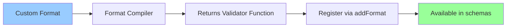

### Custom Keywords

To add custom keywords, you would extend the compilation pipeline in `schema.js`:

```javascript
// In compileSchemaObject or a new module
function compileCustomKeyword(schemaObj, jsonSchema) {
  if (jsonSchema.myKeyword === undefined) return undefined;

  const addError = schemaObj.createErrorHandler(value, 'myKeyword');

  return function validateMyKeyword(data, dataPath) {
    // Custom validation logic
    return isValid(data) || addError(data, dataPath);
  };
}
```

---

## Testing Strategy

The architecture supports comprehensive testing at multiple levels:

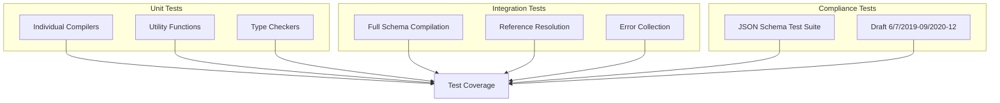

---

## Data Structures

### schemasMap Structure

```typescript
Map<string, schema | null> {
  // Root schemas
  "http://example.com/schema#" → { type: "object", properties: {...} }

  // Internal refs (after Phase 2, these point to final schemas)
  "#/$defs/foo" → { type: "string" }  // Flattened: was A→B→C, now A→C
  "#/$defs/bar" → { $ref: "#/$defs/foo" }  // If not yet resolved

  // Anchors
  "http://example.com/schema#myAnchor" → { type: "number" }
  "#myAnchor" → { type: "number" }  // Global anchor
}
```

### ValidationRoot.#objects Structure

```typescript
Map<string, ValidationObject> {
  "http://example.com/schema#" → ValidationObject {
    #path: "http://example.com/schema#",
    #validator: function validateObject(data, root) {...},
    #schema: { type: "object", ... },
    #root: ValidationRoot
  },

  "#/$defs/foo" → ValidationObject {
    #path: "#/$defs/foo",
    #validator: function validateString(data, root) {...},  // Direct reference
    #schema: { type: "string" },
    #root: ValidationRoot
  }
}
```

---

## Key Functions Reference

| Function | File | Purpose |
|----------|------|---------|
| `storeSchemaIdsInMap` | traverse.js | BFS traversal storing all schema IDs and refs |
| `resolveRefSchemaShallow` | traverse.js | Resolve single ref hop (baseUri + fragment) |
| `resolveRefSchemaDeep` | traverse.js | Follow ref chain to final schema |
| `restoreSchemaRefsInMap` | traverse.js | Flatten all ref chains at load time |
| `isReferenceHop` | traverse.js | Whether a schema a reference reached is a pure `$ref` hop that `resolveRefSchemaDeep` flattens away (no asserting sibling); `#precompileRefs` builds such a hop rather than the end held under its pointer |
| `placeDraft` / `unwalkedReading` | index.js | The draft a reference target compiles under: its place's, or, for a place no walk recorded, the nearest `$schema` (or recorded place) on the way to it, which names the dialect whose vocabularies `optionsAt` reads there too |
| `multipleOfTester` | `@jarenjs/core/math` (decimal.js), through number.js | Whether a value is a whole multiple of a step, decided on the decimals both spell (`shortestDecimal`), exactly at every magnitude; the schema's `multipleOf` and a `$data` step read it, and `@jarenjs/forms`' field check shares it |
| `createJsonPointer` | traverse.js | Parse URI into components (id, leftUri, fragment), its scheme and host lowered (by the URL standard for `http:` and `https:`, by `caselessUri` for every other scheme); a compile parses each reference once per base and option set (`withParsedPointers`) |
| `caselessUri` / `heldUriKey` | schema-keywords.js | The one spelling of a URI a schema is held and looked up by: scheme and host in lower case (RFC 3986), the rest as written; `heldUriKey` adds the empty fragment (`addSchema`, `getSchema`, `dialectDraft`, `compileAsync`) |
| `identifierKeyword` | schema-keywords.js | The keyword that identifies a schema object: `$id`, else the draft-04 `id` where its document declares no known draft (the walk, `indexSchemaResources`, the strict profile's index) |
| `indexSchemaResources` / `resolveSchemaReference` | references.js | The resources of a document as the validator registers them (each embedded `$id` starts one; each with its plain names) and the base each schema object's `$ref` resolves against; one reference resolved inside the resource its URI names. The normalizer, `@jarenjs/emit` and the strict profile resolve through it. Each `$schema` is read by name, or, handed a validator as `dialects` (`heldDialects`), through the meta-schemas it holds (`index.held`), the map its compile reads a dialect through |
| `identifierOf` / `declaredDraftOf` | traverse.js | The identifier text a compile reads a base from (`$id`, or `id` where `identifierKeyword` reads it), by the draft the walks recorded for the object |
| `identifierText` | schema-keywords.js | An identifier read without a fragment spelled as a JSON Pointer, which names nothing (every reader of an `$id`/`id`) |
| `readsPrefixItems` / `readPrefixItems` | schema-keywords.js | Whether a place reads `prefixItems` (2020-12, or no draft declared), the one gate the validator, the normalizer and `@jarenjs/emit` read; `readPrefixItems` also reads an empty one as none |
| `defaultPlace` / `settleFill` / `unfilledDefaults` | normalize.js | The schema objects that may apply at one place of an instance (for certain: beside, through `$ref` and `allOf`; as the instance decides: below a branch; from every parent object), against which the validator decides each default: never filled where a schema applying for certain refuses its copy as the place ends up holding it (`filledValue`, `stepOrder`) or its name, filled per instance where a branch or a count, presence or whole-object keyword could change an answer (`readsPresence`, `placeAnswers`: every entry of the place answers alike), always else. A member's, an item's or the root's place whose objects read its whole value (`readsWholeValue`: an `enum`, `const` or `uniqueItems`, an instance reference below it that climbs back to it, `climbsTo`, or at the root one that may read anywhere, `documentReads`) guards the defaults below it (`guardedStep`): a call that filled one runs the value through the steps compiled without defaults too (built once the document has compiled, `settleDocument`) and keeps the defaults where every entry of the place answers the two alike (`answersChange`, the rule `fillChecked` applies). The checks run on one `JarenValidator` holding the document (`checkerOf`: the host's `createValidator` called with the compile's bounds, else one of those bounds), compiled once, the root checked on the value itself so a pointer from the instance's root reads it; `unfilledDefaults` names the defaults never filled or filled per instance, those below a guarded place among them, for `@jarenjs/emit` |
| `compileNode` / `openFrame` / `enterAgain` | normalize.js | The normalizer's compile, one frame per object it is building (`ctx.compiling`, the frame held in the memo while it builds): an object nested past the compile's `maxSchemaDepth` (default `SCHEMA_DEPTH_CEILING`) levels from the root or a reference's target is refused `JK0017`; reaching an object still being built closes a loop, refused `JK0001` when every frame from the root applied to the value itself (`$ref`, `allOf`), and otherwise entered through `boundReference` at the compile's `maxReferenceDepth`, weighing the frames between (a frame that only forwards to its `$ref` target weighs none). Both options are read and refused by the validator's `assertDepthOption`, and the checks' validator is built with them. A chain of references compiles one link inside the next, so a host stack that gives out during the compile is refused `JK0017` at the frame being built, the host's error its `cause` (`compileStackRefusal`, recognised by `isStackExhausted`, never by a length); the guard's hooks live in helpers (`guardAt`, `guarding`, `reachedAgain`) so `compileNode`'s own frame, which every link holds, is no larger |
| `withoutUnreadVocabularies` / `dialectVocabulary` / `holdDialects` | normalize.js, schema-keywords.js | The document as the validator holding its dialects reads it (no validation keyword where the governing dialect leaves that vocabulary out, below a member no walk enters too, under the nearest `$schema` on the way, as `unwalkedReading` reads a reference's target there; `JK0016` for an unimplemented required vocabulary at a walked place, where below such a member the place is left as written), the one reading of a dialect's `$vocabulary`, and the dialect stubs a reader's own validator holds |
| `documentPlace` / `ValidationObject#place` / `locationOf` | traverse.js, index.js | Where a schema object lies in its document, as every compile refusal names it (`docPath`): a JSON Pointer, every token escaped, alone after `#` in the compiled document (the compile's walks record its places in a map of that compile, `compiledPlacesOf`), after the document's name in a held one (`places.locations`, recorded by the registration walks for each document root and identified object). A subschema's place is its holder's and the step below it; a reference target's is the one recorded for it, else one a key naming it reaches by its pointer (the key it is built under, the reference, any key of the map). The object's `path` stays its key (an embedded resource's `$id`); only refusals read the place, so it is computed when one is thrown |
| `ValidationRoot#optionsAt` / `dialectVocabularies` | index.js | The options a schema object compiles under: the compilation's, with the vocabularies and draft-defaulted assertions of the dialect governing its place |
| `JarenValidator.compile` | index.js | Main entry point for schema compilation, draft/vocabulary selection |
| `JarenValidator.#precompileRefs` | index.js | Pre-create ValidationObjects for the refs a compile reaches |
| `ValidationObject.compileValidator` | index.js | Compile validator, ref combination, dynamic-anchor registration |
| `ValidationRoot.resolveObject` | index.js | Resolve ref to ValidationObject (fallback only) |
| `ValidationRoot.referencedSchema` | index.js | The id and schema a `$ref` leads to, without building it (the location-reader scan follows references with it) |
| `wrapUnevaluated` | unevaluated.js | Final-stage unevaluatedProperties/unevaluatedItems check |
| `EvalLog` | tools.js | Annotation log with mark/rollback for unevaluated*, and a one-pass index of a long stretch for a check over many members |
| `collectDynamicAnchorsDeep` | dynamic-ref.js | Gather a resource's $dynamicAnchors for scope entry |

---

## Implementation Notes

### How $ref Works

1. **Draft 7 and earlier - $ref ignores siblings**: when a schema has `$ref`, all other keywords are ignored, the referenced schema completely replaces the current schema, and a sibling `$id` does not affect `$ref` resolution
2. **Draft 2019-09 and later - $ref has siblings**: `$ref` is just another keyword; sibling keywords apply together with the referenced schema, and a sibling `$id` DOES establish the base URI the `$ref` resolves against
3. **Location-independent identifiers**: Anchors like `#foo` should be resolvable within their document
4. **Ref chain resolution happens at compile time**: pre-resolved via `restoreSchemaRefsInMap` and `#precompileRefs`

### Base URI Resolution

When schemas have `$id` that changes the base URI:

```jsonc
{
  "$id": "http://example.com/schema",
  "$defs": {
    "nested": {
      "$id": "nested/",
      "$defs": {
        "deep": {
          "$ref": "folder/file.json"  // Resolves against http://example.com/nested/
        }
      }
    }
  }
}
```

**Resolution Rules**:
1. `$id` changes the base URI for itself and all children
2. `$ref` is resolved against the current base URI
3. Relative `$id` values resolve against the parent's base URI
4. Trailing `#` is stripped for URL resolution

### ECMAScript Regex in JSON Schema

1. **Unicode flag required**: All regex patterns use the `u` flag for proper Unicode support
2. **Unicode property escapes**: Patterns using `\p{...}` require the `u` flag
3. **Surrogate pairs**: Non-BMP characters (like emojis) are represented as surrogate pairs in JavaScript

---

## Debugging Guide

### "JK0009: Can not resolve schema for 'X'"

**Cause**: The ref `X` is not in schemasMap, or its pointer misses in the
document that is (the message then names the step that misses)

**Check**:
- Was the schema containing `X` added via `addSchema()`?
- Is the ref path correct in the schema?
- After `restoreSchemaRefsInMap`, every ref the compile reaches has a non-null value (a held one it does not reach stays `null`)
- `JK0008` instead: a draft-07 `$ref` beside an `$id` resolves against the
  enclosing base, not the `$id`. In a registered document that declares no
  `$schema` each compile reads it under its own draft: the walk records both
  bases (`refBases`, `undecidedBases`), `resolveRefSchemaDeep` and
  `restoreSchemaRefsInMap` take the compile's draft, and a draft-07 compile
  drops the entries only the 2019-09 reading needs (`lateTargets`)
- A `$dynamicRef` or `$recursiveRef` target is resolved by the `$ref`
  resolver on the call that reaches it; nothing found is `JK0009` there.
  Neither is compiled where its document declares a draft that does not
  define it (`admitsDynamicReference`: `$recursiveRef` 2019-09,
  `$dynamicRef` 2020-12, both where none is declared or the `$schema` names
  no draft this package knows: the walks record such places in
  `places.foreign`, read through `dynamicReferenceDraft`)
- `JK0011`: a `$recursiveRef` other than `"#"` read as 2019-09
  (`compileRecursiveRef` reads the place's declared draft, else the
  compile's); a document that declares no draft, compiled as another,
  applies nothing for it
- `JK0012`: an identifier names two schemas; `storeSchemaIdsInMap`'s
  `declare` refuses the second place (offered to `onFault` under
  `addSchema`, which keeps the first, and records the identifier in
  `places.contested` when the two places differ, as its merge does for a
  nested identifier two registered documents declare);
  `resolveRefSchemaShallow` and the compile-time reads (`compileValidator`,
  `resolveObject`, the dynamic references' initial target) refuse a
  reference read through a contested identifier, except one the place held
  under it makes against it (admitted per holder, `#ownReads`), and
  `resolveObject` builds a target whose place declares one under the
  reference, not the identifier
- `JK0010`: the reference or `$id` text is no URI; `createJsonPointer` codes
  the `URL` parse failure, and the callers that know the keyword and its
  place name them
- `JK0013`, `JK0014`: a keyword value of the wrong shape, or a pattern that
  is no regular expression; `admitKeywordValues` runs first in
  `compileSchemaObject`, over the keywords the place reads (its declared
  draft's, under the vocabularies its dialect keeps on, beside the keyword
  each depends on), so no keyword compiler sees a value of another shape.
  `KEYWORD_SHAPES` is the table, read from one short shape descriptor per
  group of keywords that both checks a value and words the refusal;
  `test/validate/keyword-values-meta.test.js`
  derives it from the meta-schemas `@jarenjs/refs` ships and names each
  place it reads more widely
- `JK0015`: under `unknownFormats: 'error'`, an asserting `format` that
  names no registered format; `compileFormatBasic` (format.js) refuses it
  after the assertion gate, so an annotation-only `format` and a `$data`
  reference never reach it, and `getSchemaFormatCompiler` reads only the
  registry's own members
- `JK0016`: a dialect whose meta-schema requires a vocabulary this package
  does not implement (`declaredVocabularies` names it against
  `IMPLEMENTED_VOCABULARIES`); `optionsAt` refuses it where a place under
  the dialect compiles, `withoutUnreadVocabularies` for the readers

### Performance Degradation on First Validation

**Cause**: Refs being resolved at validation time instead of compile time

**Check**:
- Is `#precompileRefs` being called in `compile()`?
- Are ValidationObjects being created for the refs the compile reaches (`reachedKeys`)?
- Verify: `compileValidator` should find targets immediately without fallback

### Test Interference (tests pass individually but fail together)

**Cause**: Global shared state between validators

**Check**:
- Are you using a global cache? (Don't)
- Solution: All state should be per-ValidationRoot or per-JarenValidator. A
  module-level table may only keep the answers of a pure reading of a short
  string, bounded (`memberPath`'s member tokens, the dialect URI readings in
  `schema-keywords.js`); the pointer parses `withParsedPointers` keeps live
  only while one compile runs

### Debugging Ref Resolution

Enable debug logging in traverse.js:

```javascript
// In packages/validate/src/traverse.js
console.log('Resolving ref:', ref, 'against baseUri:', baseUri);
```

---

## Related Documentation

For broader context on how this package fits into the JarenJS ecosystem:

- **Project-wide Architecture**: See `docs/ARCHITECTURE.md`
- **Developer Guide**: See `docs/HOWTO.md`
- **Core Package**: Depends on `@jarenjs/core` for fundamental utilities and `@jarenjs/json` for the JSON addressing standards

---

## Key Files Reference

| File | Purpose | Key Exports |
|------|---------|-------------|
| `index.js` | Public API | `JarenValidator`, `ValidationOptions`, `ValidatorOptions` |
| `messages.js` | Error conversion & i18n | `ValidationError`, `convertInternalErrors`, `messagesEn`, `compileMessageTemplate`, `compileMessageCatalog`, `renderErrorMessage`, `localizeErrors`, `compileErrorMessageSpec` |
| `output.js` | Standard output formats (`@jarenjs/validate/output`) | `flagOutput`, `basicOutput`, `detailedOutput`, `verboseOutput`, `listOutput`, `hierarchicalOutput`, `distinctBasicOutput`, `distinctDetailedOutput`, `distinctListOutput` |
| `strict-profile.js` | Strict structured-output profiles (`@jarenjs/validate/strict-profile`) | `relaxSchema`, `deriveStrictProfile`, `strictProfileSize` |
| `schema.js` | Schema compilation | `compileSchemaObject` |
| `keyword-values.js` | Keyword value admission | `admitKeywordValues`, `KEYWORD_SHAPES` |
| `traverse.js` | Schema traversal | `TraverseOptions`, `storeSchemaIdsInMap`, `resolveRefSchemaDeep` |
| `tools.js` | Shared utilities | `isBoolOrObjectClass`, `hasSchemaReference`, `createIsSchemaTypeHandler` |
| `origin.js` | The default base a schema without `$id` is read under (the compile, `compileAsync`, the resource index), the resource a URI names, and a location's JSON Pointer tokens escaped for a URI fragment | `DEFAULT_ORIGIN`, `withoutFragment`, `encodeJsonPointerPath` |
| `references.js` | The reading of a document's references (`@jarenjs/validate/references`), without the validator | `indexSchemaResources`, `resolveSchemaReference`, `collectSameDocumentAnchors`, `resolveSameDocumentRef` |
| `string.js` | String keywords | `compileStringBasic` |
| `number.js` | Number keywords | `compileNumberBasic`, `multipleOfTester` (from `@jarenjs/core/math`) |
| `bigint.js` | BigInt keywords | `compileBigIntBasic` |
| `array.js` | Array keywords | `compileArraySchema` |
| `object.js` | Object keywords | `compileObjectSchema` |
| `combine.js` | Logic keywords | `compileCombineSchema` |
| `condition.js` | If/then/else | `compileConditionSchema` |
| `property-dependencies.js` | `propertyDependencies` proposal keyword (opt-in) | `compilePropertyDependencies` |
| `enum.js` | Enum/const | `compileEnumBasic` |
| `format.js` | Format registry | `registerFormatCompiler`, `compileFormatBasic` |
| `content.js` | Content encoding | `compileContentSchema` |
| `data.js` | Data keyword | `compileDataSchema` |
| `dollar-data.js` | $data keyword | `compileDollarDataSchema` |
| `unevaluated.js` | unevaluated* keywords | `wrapUnevaluated` |
| `dynamic-ref.js` | Dynamic scope helpers | `collectDynamicAnchorsDeep`, `hasRecursiveAnchor`, `getDynamicAnchorName` |
| `query-keyword.js` | `$query` extension keyword | `compileQuerySchema` |

---

## Architectural Decisions

### 1. Compilation over Interpretation

**Decision**: Compile schemas to functions rather than interpret them at runtime.

**Rationale**:
- Eliminates schema traversal during validation
- Enables V8 optimization of hot paths
- Allows fast-path specialization

**Trade-off**: Higher memory usage for storing compiled functions.

### 2. Pre-compiled References

**Decision**: Resolve all `$ref` at compile time, not validation time.

**Rationale**:
- Eliminates recursive lookup overhead during validation
- Flattens reference chains (a→b→c becomes a→c)
- Enables circular reference detection at compile time

### 3. Lazy Error Generation

**Decision**: Only create error objects when `skipErrors` is false, and
only produce human-readable text at report time (`convertInternalErrors`
in messages.js), over the already-failed set, from a `msgid` + `params`
pair through a message catalog.

**Rationale**:
- Most production use cases only need boolean results
- Error object creation is expensive
- Reduces GC pressure during high-throughput validation
- Structured-first errors make locale a report-time choice: switching
  language (`localizeErrors`, `@jarenjs/locales`) never recompiles a
  validator, and the `errorMessage` keyword resolves against a registry
  with zero validation-time cost (see docs/ERROR-MESSAGES.md)

### 4. Dual Data Reference Systems

**Decision**: Support both `$data` (Ajv-style) and `data` (json-everything-style) keywords.

**Rationale**:
- Maximizes compatibility with existing schema ecosystems
- Different use cases favor different reference styles
- Minimal overhead when not used

### 5. Annotation Tracking via a Shared Log

**Decision**: Implement `unevaluatedProperties`/`unevaluatedItems` with a per-root `EvalLog` of `(instance, key)` pairs and mark/rollback semantics, compiled in only when the schema set uses these keywords.

**Rationale**:
- Instance-identity keying makes annotations flow correctly through `$ref` chains and recursion without threading context through every validator signature
- mark/rollback gives failed applicator branches (anyOf/oneOf/not/if) exact annotation-discarding semantics
- The compile-time feature scan keeps schemas without unevaluated* keywords completely free of tracking overhead
- A check over many members (items) gathers the stretch of the log since its mark into a set in one pass (`EvalLog.index`), so its cost grows with the instance rather than with the instance's square; a short stretch is still scanned per member, which is cheaper there
- When errors are collected, the checks also run beside a failed sibling, and `properties`, `patternProperties`, `additionalProperties`, `items` and `prefixItems` log every member they matched, pass or fail (`annotatesFailedMembers`), so a member a sibling already reported is not reported again as unevaluated; such an entry only ever sits inside a schema that fails, or a branch an applicator rolls back

### 6. Dynamic Scope as One Stack

**Decision**: Track the dynamic scope for `$recursiveRef`/`$dynamicRef` as one stack of (anchor name, validator) entries per compilation (`ValidationRoot#dynamicScope`), pushed on resource entry (root validation and `$ref` crossings); a frame reads the stack's height on entering and restores it by assignment on exit.

**Rationale**:
- Entering a resource registers ALL of its `$dynamicAnchor`s (collected once at compile time), matching the specification's resource-based dynamic scope
- Outermost-first resolution is the first entry of the name from the bottom
- Restoring the height read on entering, in a `finally`, keeps the scope correct across validation failures, and across a host stack that gives out: a call made while the stack is full throws again, so a pop that calls could leave an anchor in scope for every later validation, where an assignment cannot

---

*This document was generated for contributors to understand the architecture of @jarenjs/validate. For implementation details, refer to the source code and inline JSDoc comments.*
